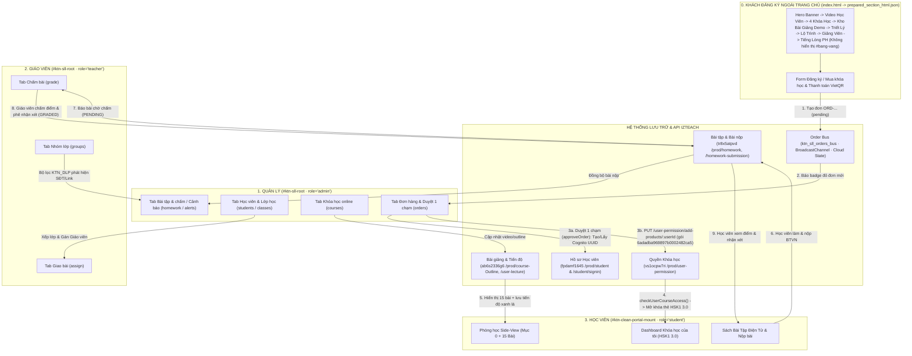

# AGENTS.md — Quy Chuẩn Kiến Trúc (Cổng Mua Hàng + 3 Role) & Ma Trận Móc Nối

> Áp dụng bắt buộc cho mọi Agent / Subagent khi đọc, sửa, build hoặc deploy bất kỳ file nào trong `d:\Vibe\khongtunhi_sofl_style\`.

---

## 1. BỨC TRANH TỔNG THỂ: CỔNG KHÁCH MUA HÀNG + 3 ROLE TRONG HỆ THỐNG

Hệ thống Học Viện Khổng Tử Nhí gồm **1 Cổng Khách Hàng bên ngoài (`https://khongtunhi.com`)** móc nối trực tiếp với **3 Role bên trong Cổng Sổ Liên Lạc & LMS (`/custom-page/so-lien-lac-test` — Page ID `6adff7ba36309b0002b6e659`)**:

| Phân khu / Role | URL / Tài khoản thực tế | Khung DOM hiển thị | Các màn hình / chức năng chính | File nguồn phụ trách (Source of Truth) |
|-----------------|-------------------------|--------------------|--------------------------------|----------------------------------------|
| **0. KHÁCH ĐĂNG KÝ / MUA HÀNG (Storefront)** | Trang chủ: `https://khongtunhi.com`<br>(Khách vãng lai / Phụ huynh đăng ký) | Trang chủ Landing Page độc lập | • Xem thông tin khóa học, video học viên, đội ngũ giảng viên & học thử *(đã gỡ bỏ mục `#bang-vang` Bảng Vàng Thành Tích Học Viên)*<br>• Điền Form Đăng ký / Mua khóa học<br>• Quét mã thanh toán **VietQR** (`890.000đ` / gói HSK1 3.0)<br>• Tạo đơn hàng `ORD-...` (`approvalStatus: 'pending'`) bắn sang Quản lý | • **File gốc**: `index.html`<br>• **Gói biên dịch CDN**: `prepared_section_html.json`<br>• **Script deploy trang chủ**: `deploy_clean_live.cjs` / `deploy_homepage_production.cjs` |
| **1. QUẢN LÝ (Admin)** | `/custom-page/so-lien-lac-test`<br>• `quanly@khongtunhi.com`<br>• `hocvienkhongtunhi123@gmail.com` | `#ktn-sll-root`<br>(`app.currentRole = 'admin'`, `body.lms-on`) | • `dash`: Tổng quan<br>• `orders`: **Đơn hàng & Duyệt 1 chạm** (nhận đơn từ trang chủ)<br>• `students`: Học viên (đồng bộ izTeach)<br>• `classes`: Lớp học & Xếp lớp<br>• `teachers`: Giáo viên<br>• `courses`: Khóa học online<br>• `homework`: Bài tập & chấm<br>• `groups`: Nhóm lớp<br>• `alerts`: Cảnh báo DLP | • Khung HTML: `so-lien-lac.html`<br>• Bảng Quản lý & Đơn hàng: `so-lien-lac-lms.js`, `so-lien-lac-lms.css`<br>• Logic Duyệt đơn 1 chạm & State: `so-lien-lac-ux.js`, `so-lien-lac-ux.css`<br>• Xác thực: `so-lien-lac-auth.js`, `so-lien-lac-auth.css` |
| **2. GIÁO VIÊN (Teacher)** | `/custom-page/so-lien-lac-test`<br>• `linh.lam@khongtunhi.com`<br>• `thu.ha@khongtunhi.com`<br>• `minh.anh@khongtunhi.com` | `#ktn-sll-root`<br>(`app.currentRole = 'teacher'`, `body.lms-on`) | • `grade`: Chấm bài (chấm điểm, phê nhận xét, gửi audio/ảnh)<br>• `assign`: Giao bài tập mới theo Lớp/Bài<br>• `groups`: Nhóm lớp (trao đổi với phụ huynh/học sinh lớp mình dạy) | • Sidebar Giáo viên: `so-lien-lac-lms.js` (`navItems('teacher')`)<br>• Logic Chấm bài & Giao bài: `so-lien-lac-ux.js` (`switchTeacherTab`, `submitTeacherGrade`, `assignHomework`) |
| **3. HỌC VIÊN (Student)** | `/custom-page/so-lien-lac-test`<br>• Đã mua: `taphong2002@gmail.com` (`bc21991c-ce9b-465d-b85f-dbb1821e51a9`)<br>• Chưa mua: `taphong2002vip@gmail.com` | `#ktn-clean-portal-mount`<br>(ẩn `#ktn-sll-root`) | • **Dashboard**: Chỉ hiện thẻ khóa học `HSK1 3.0` khi đã được cấp quyền (chưa mua -> ẩn hoàn toàn)<br>• **Side-View Phòng học**: Mục `0` (Tài liệu) + `15 Bài học` (chưa học = trắng, xong = xanh lá)<br>• **Bài giảng**: Video HLS + Sách bài tập điện tử tương tác (nghe audio nhúng, làm bài, nộp BTVN) | • **File gốc duy nhất**: `portal_template.html`<br>• Script đóng gói 15 bài + 127 audio: `build_clean_real_portal.js`<br>• *(File sinh tự động `demo_hsk1_student_portal.html` — CẤM SỬA TRỰC TIẾP)* |

---

## 2. SƠ ĐỒ MÓC NỐI KHÉP KÍN: TỪ KHÁCH MUA HÀNG -> QUẢN LÝ -> HỌC VIÊN -> GIÁO VIÊN



---

## 3. MA TRẬN 6 MÓC NỐI TÍNH NĂNG (CÁI GÌ NỐI VỚI CÁI GÌ)

> Khi cần sửa hoặc nâng cấp bất kỳ tính năng nào, **tra bảng này để biết chính xác các điểm móc nối giữa Cổng Mua Hàng và 3 Role**:

### Móc nối 0: Khách đăng ký mua hàng ngoài Trang chủ -> Đơn hàng chờ duyệt của Quản lý
- **Luồng hoạt động**:
  1. **Khách hàng ngoài trang chủ (`index.html`)** điền Họ tên, SĐT, chọn gói học (mặc định map về `courseId: '6adadba969897b0002482ca5'` — *HSK1 3.0*) và bấm đăng ký / xác nhận chuyển khoản VietQR.
  2. Hàm tạo đơn trong `index.html` sinh mã `orderId: 'ORD-' + ...` với `approvalStatus: 'pending'`, sau đó đẩy vào:
     - `localStorage.getItem('ktn_sll_orders_bus')` và `localStorage.getItem('ktn_sll_v1_state').orders`
     - `BroadcastChannel('ktn_sll_orders_bus')` phát sự kiện `{ type: 'NEW_ORDER', order: newOrder }`
     - Webhook Google Sheet (`window.KTN_GOOGLE_SHEET_WEBHOOK`)
  3. **Quản lý (`role = 'admin'`)** đang mở `#ktn-sll-root`:
     - Hàm `D.orders()` và listener `BroadcastChannel('ktn_sll_orders_bus')` trong `so-lien-lac-lms.js` (dòng 246 & 1814) tự động bắt đơn mới, nhảy số đỏ trên menu **Đơn hàng & Duyệt (`orders`)** ngay lập tức mà không cần tải lại trang.
- **Điểm cần chú ý khi sửa**: Không được đổi tên khóa `ktn_sll_orders_bus` hoặc cấu trúc trường `orderId`, `studentName`, `studentEmail`, `phone`, `courseId`, `approvalStatus` giữa `index.html` và `so-lien-lac-lms.js` / `so-lien-lac-ux.js`.

---

### Móc nối 1: Quản lý bấm "Duyệt 1 chạm" -> Tạo tài khoản izTeach & Mở khóa cho Học viên
- **Luồng hoạt động**:
  1. **Quản lý (`role = 'admin'`)** vào tab **Đơn hàng & Duyệt (`orders`)** -> Bấm nút **Duyệt & Kích hoạt** (`app.approveOrder(orderId)` trong `so-lien-lac-ux.js`, dòng 5620–5960).
  2. **Bước 1 — Định danh Cognito UUID (`userId`)**:
     - Gọi `GET / POST https://fpdamf1645.execute-api.ap-southeast-1.amazonaws.com/prod/student` và `/prod/student/signin` để tạo hoặc lấy đúng **AWS Cognito UUID** (`userId` dạng `xxxxxxxx-xxxx-xxxx-xxxx-xxxxxxxxxxxx`) của học viên (có `isValidCognitoUuid(userId)` bảo vệ, không bao giờ truyền nhầm MongoDB 24-hex ObjectId).
  3. **Bước 2 — Cấp quyền khóa học trên Backend izTeach**:
     - Kiểm tra quyền hiện có qua `GET https://vs1ocpw7ri.execute-api.ap-southeast-1.amazonaws.com/prod/user-permission?vendorId=...&userId=...`.
     - Gọi `PUT https://vs1ocpw7ri.execute-api.ap-southeast-1.amazonaws.com/prod/user-permission/add-products/:userId` với `productIds: ['6adadba969897b0002482ca5']`, `productType: 'online-course'`.
  4. **Bước 3 — Đồng bộ hồ sơ & Mở khóa bên Học viên**:
     - Đổi `order.approvalStatus = 'approved'`, thêm học viên vào `app.students` (`hasOnlineCourses: true`), lưu Cloud State (`app.saveState()`) và mở popup bàn giao tài khoản/mật khẩu.
     - Khi **Học viên (`role = 'student'`)** đăng nhập vào `/custom-page/so-lien-lac-test`: Hàm `checkUserCourseAccess(user)` trong `portal_template.html` đọc quyền từ `vs1ocpw7ri /prod/user-permission` -> Mở khóa ngay thẻ **HSK1 3.0** (`#enrolled-course-card`).
     - Ngược lại, tài khoản chưa được duyệt đơn (`hasAccess: false`, ví dụ `taphong2002vip@gmail.com`) -> Ẩn hoàn toàn thẻ khóa học, chỉ hiện `#empty-course-state` (*"Chưa có khóa học nào"*).

---

### Móc nối 2: Đăng nhập Duy Nhất Qua Popup Trang Chủ, Giữ Phiên & Định Tuyến 3 Role
- **Luồng hoạt động**:
  1. **Chỉ có DUY NHẤT 1 Popup Đăng Nhập tại Trang chủ (`https://khongtunhi.com`)** (`openKtnLoginModal()`). Tuyệt đối không có trang phụ đăng nhập riêng (`#auth-shell` đã bị xóa bỏ hoàn toàn). Nếu khách chưa đăng nhập truy cập vào `/custom-page/so-lien-lac-test`, hệ thống tự động đưa về `/?login=1` và bật sẵn Popup Đăng Nhập trên trang chủ.
  2. Khi đăng nhập thành công trên Popup Trang chủ:
     - Lưu phiên vào `localStorage.ktn_sll_persistent_auth_v2`, `localStorage['ol-credentials-auth-user']` và cookie `ktn_sll_auth_v2`.
     - Chuyển sang `/custom-page/so-lien-lac-test`, hàm `window.__syncKtnPortalViewByRole()` (`deploy_so_lien_lac_live.cjs`) kiểm tra email & role:
       - **Quản lý (`admin`)** hoặc **Giáo viên (`teacher`)** -> Hiển thị `#ktn-sll-root`, ẩn `#ktn-clean-portal-mount`.
       - **Học viên (`student`)** -> Ẩn `#ktn-sll-root`, hiển thị `#ktn-clean-portal-mount`, gọi `window.syncPortalState()` (`portal_template.html`).
  3. Khi bấm **Đăng xuất** ở bất kỳ Role nào (`logoutRealUser()` hoặc `sllAuth.logout()`):
     - Xóa sạch toàn bộ session ở cả `localStorage`, `sessionStorage`, `cookie` và đưa thẳng về trang chủ mở sẵn Popup Đăng Nhập (`/?login=1`).

---

### Móc nối 3: Bài giảng, Tiến độ Bài học (Trắng / Xanh lá) & Mục 0 Tài liệu
- **Luồng hoạt động**:
  1. **Quản lý (`role = 'admin'`)** quản lý khóa học tại tab **Khóa học online (`courses`)** và trên izTeach (`ab6s2336g6 /prod/course-Outline`).
  2. **Học viên (`role = 'student'`)** bấm vào thẻ **HSK1 3.0** -> Vào **Phòng học Side-View** (`#classroom-view` trong `portal_template.html`):
     - Thanh bên trái (`#lesson-list-sidebar`) gồm:
       - **Mục `0` (`Tài liệu học tập`)**: Trọn bộ 5 PDF sách giáo khoa, sách bài tập, vở luyện viết, flashcard.
       - **Bài `1` → `15`**: Video bài giảng HLS (`m3u8`) + Từ vựng/Ngữ pháp + Sách bài tập điện tử ở ngay bên dưới.
     - **Màu sắc trạng thái bài học**:
       - Chưa học: Màu trắng mặc định.
       - Đã hoàn thành: Chuyển sang **màu xanh lá** (`.lesson-item.completed`), đồng bộ lên `ab6s2336g6 /prod/user-lecture` và `localStorage`, giữ nguyên khi đăng xuất/đăng nhập lại.

---

### Móc nối 4: Sách Bài Tập Điện Tử, Nộp bài & Chấm bài (Học viên <-> Giáo viên <-> Quản lý)
- **Luồng hoạt động**:
  1. **Học viên (`role = 'student'`)** xem xong video bài giảng -> Làm bài ngay trên **Sách bài tập điện tử tương tác** nằm dưới video (`renderInteractiveWorkbook(lessonId)` trong `portal_template.html`):
     - Bấm nút loa nghe trực tiếp 127 file audio nhúng vào từng bài (không cần mở file PDF rời).
     - Chọn đáp án trắc nghiệm / đính kèm ảnh vở viết / ghi âm rồi bấm **Nộp bài** -> Gửi lên `tr8x5atpvd /prod/homework` & `/homework-submission` và đồng bộ vào `app.state.homeworks`.
  2. **Giáo viên (`role = 'teacher'`)** mở tab **Chấm bài (`grade`)** (hoặc **Quản lý** mở tab **Bài tập & chấm (`homework`)**) trong `#ktn-sll-root`:
     - Nhận bài nộp ở trạng thái `PENDING` (`D.pending()`).
     - Giáo viên chấm điểm, ghi nhận xét -> Chuyển trạng thái sang `GRADED`.
  3. **Học viên (`role = 'student'`)** thấy điểm số và lời phê của cô giáo ngay trong bài học.

---

### Móc nối 5: Quản lý Học viên, Xếp lớp, Nhóm lớp & Cảnh báo An toàn DLP
- **Luồng hoạt động**:
  1. **Quản lý (`role = 'admin'`)** vào tab **Học viên (`students`)** -> `app.lmsFetchIz()` tải danh sách học viên thật từ `fpdamf1645 /prod/student`, xếp vào **Lớp học (`classes`)** và gán **Giáo viên (`teachers`)**.
  2. **Giáo viên (`role = 'teacher'`)** thấy đúng các lớp mình phụ trách (`D.visibleClasses('teacher')`) ở các tab **Chấm bài**, **Giao bài**, **Nhóm lớp (`groups`)**.
  3. Mọi tin nhắn trong **Nhóm lớp (`groups`)** được kiểm duyệt bởi `window.KTN_DLP` (`so-lien-lac-ux.js`). Nếu phát hiện SĐT, link Zalo/Facebook trái phép -> Tự động chặn và tạo cảnh báo đỏ tại tab **Cảnh báo (`alerts`)** của **Quản lý**.

---

## 4. QUY TẮC BẮT BUỘC KHI CẬP NHẬT / SỬA CODE (CHỐNG SỬA CHỒNG CHÉO)

### A. Bảng File Gốc (Single Source of Truth) vs File Dẫn Xuất
| Khi muốn sửa... | CHỈ ĐƯỢC SỬA FILE NÀY | TUYỆT ĐỐI KHÔNG SỬA TRỰC TIẾP | Lệnh cập nhật bắt buộc |
|-----------------|-----------------------|-------------------------------|------------------------|
| Trang chủ / Form Khách đăng ký mua hàng (`https://khongtunhi.com`) | `index.html` + đồng bộ `prepared_section_html.json` *(Lưu ý: Đã xóa vĩnh viễn section `#bang-vang` "Bảng Vàng Thành Tích Học Viên", không khôi phục lại)* | Các bản backup HTML cũ, hoặc đẩy trực tiếp `index.html` chứa đường dẫn tương đối `assets/...` lên `SectionHtml` | `node deploy_clean_live.cjs` (hoặc `node deploy_homepage_production.cjs`) |
| Giao diện / Logic Học viên (HSK1 3.0, Mục 0, Video, Sách bài tập) | `portal_template.html` hoặc `build_clean_real_portal.js` | `demo_hsk1_student_portal.html` | `node build_clean_real_portal.js` |
| Giao diện / Logic Quản lý & Giáo viên (Sidebar, Lớp, Học viên, Đơn hàng, Chấm bài) | `so-lien-lac.html`, `so-lien-lac-lms.js`, `so-lien-lac-lms.css`, `so-lien-lac-ux.js`, `so-lien-lac-auth.js` | Các file bundle `.js`/`.css` trên S3 | `node deploy_so_lien_lac_live.cjs` |
| Bộ định tuyến 3 Role & Đẩy lên `/custom-page/so-lien-lac-test` | `deploy_so_lien_lac_live.cjs` | `deploy_clean_student_portal.cjs` (ĐÃ KHÓA) | `node deploy_so_lien_lac_live.cjs` |

### B. Quy trình 3 bước chuẩn mỗi khi sửa Cổng Sổ Liên Lạc / Học Viên
```powershell
# Bước 1: Build lại gói Cổng Học Viên từ portal_template.html
node build_clean_real_portal.js

# Bước 2: Deploy bản hợp nhất (Quản lý + Giáo viên + Học viên) lên izTeach
node deploy_so_lien_lac_live.cjs

# Bước 3: Chạy kiểm thử tự động đủ các Role trên Production (nhanh 3 role hoặc toàn diện 254 kịch bản)
node verify_restored_admin_and_student_live.cjs
node run_hundreds_live_scenarios.cjs
```
