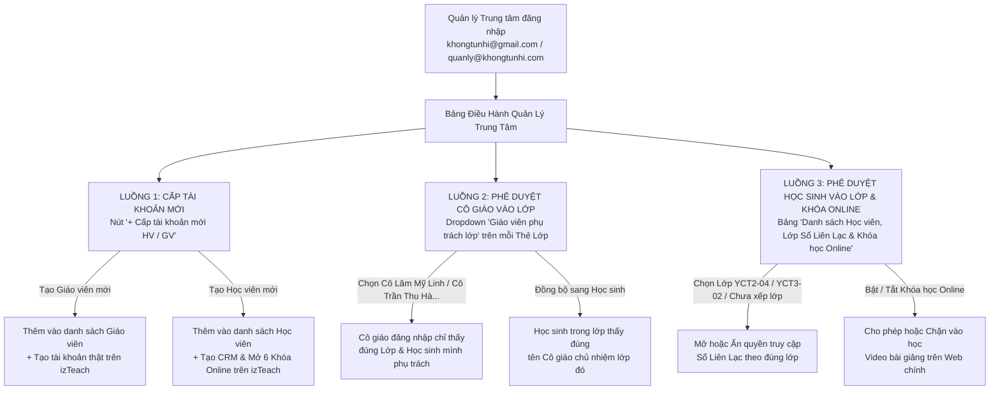

# HƯỚNG DẪN VẬN HÀNH TỔNG THỂ HỆ THỐNG SỔ LIÊN LẠC & KHÓA HỌC ONLINE — HỌC VIỆN KHỔNG TỬ NHÍ

> **Áp dụng khi**: Quản lý Trung tâm (Chị Ngọc Huyền), Giáo vụ hoặc Kỹ thuật viên cần cấp tài khoản mới, phê duyệt Cô giáo phụ trách từng lớp, phê duyệt Học sinh vào từng lớp, mở quyền Khóa học Online và giám sát an toàn liên lạc trên `https://khongtunhi.com`.

---

## 1. Bức Tranh Tổng Thể & Sơ Đồ Luồng Phê Duyệt 3 Vai Trò

Hệ thống Học Viện Khổng Tử Nhí kết nối **Web Chính (Khóa học Online `izTeach`)** và **Sổ Liên Lạc Điện Tử (`/so-lien-lac`)** thành một luồng thống nhất gồm **3 vai trò**:

| Vai trò | Quyền hạn chính | Giao diện sau khi đăng nhập |
| :--- | :--- | :--- |
| **1. Quản lý Trung tâm (Admin)** | • Cấp tài khoản mới (Học viên / Giáo viên)<br>• Mở lớp học mới<br>• **Phê duyệt Cô giáo nào phụ trách Lớp nào**<br>• **Phê duyệt Học sinh nào vào Lớp nào**<br>• Cấp/thu hồi quyền học **Khóa học Online**<br>• Giám sát toàn bộ tin nhắn & nhật ký chặn DLP | **Bảng Điều Hành Quản Lý Trung Tâm** + Xem/nhắn tin mọi lớp học |
| **2. Giáo viên / Lão sư (Teacher)** | • Chỉ nhìn thấy **các Lớp và Học sinh thuộc lớp mình được Quản lý phê duyệt phụ trách**<br>• Chấm điểm rèn luyện 4 kỹ năng, giao bài tập về nhà, duyệt bài nộp và nhắn tin với Phụ huynh trong lớp mình | **Bảng Điều Hành Giáo Viên** (Lọc theo đúng lớp được phân công) |
| **3. Phụ huynh & Học sinh (Student)** | • Xem Sổ Liên Lạc của đúng lớp mình đã được duyệt<br>• Nhìn thấy đúng **Cô giáo phụ trách lớp mình**<br>• Nộp bài tập, nhắn tin với Cô giáo & Quản lý<br>• Vào học 6 **Khóa học Online** trên trang chủ khi đã được cấp quyền | **Sổ Liên Lạc Học Sinh** + **Khóa Học Online Của Con** |



---

## 2. LUỒNG 1: Cách Cấp Tài Khoản Mới (Cho Học Viên & Giáo Viên)

Bạn có **3 cách** để cấp tài khoản mới tùy theo nhu cầu vận hành hàng ngày:

### Cách 1A — Cấp trực tiếp ngay trên Bảng Điều Hành Sổ Liên Lạc (Khuyên dùng hàng ngày)

1. Mở trang Sổ Liên Lạc: `https://khongtunhi.com/so-lien-lac` (hoặc bấm nút **"Đăng nhập"** trên thanh menu trang chủ).
2. Đăng nhập bằng tài khoản **Quản lý Trung tâm**:
   - Email: `khongtunhi@gmail.com` hoặc `quanly@khongtunhi.com`
   - Hệ thống **tự động nhận diện vai trò Quản lý** ngay khi bấm **`Đăng nhập`**.
3. Tại khung **Bảng Điều Hành Quản Lý Trung Tâm** ở đầu trang, bấm nút **`+ Cấp tài khoản mới (HV / GV)`**.
4. Điền thông tin vào biểu mẫu:
   - **1. Loại tài khoản cần cấp**: Chọn `Học viên & Phụ huynh` hoặc `Giáo viên phụ trách lớp`.
   - **2. Họ và tên**: Ví dụ `Bé Nguyễn Gia Bảo` hoặc `Cô Nguyễn Mai Anh`.
   - **3. Email đăng nhập**: Ví dụ `giabao@khongtunhi.com` hoặc `maianh@khongtunhi.com`.
   - **4. Mật khẩu khởi tạo**: Mặc định hệ thống gợi ý mật khẩu khởi tạo (Phụ huynh/Giáo viên có thể dùng ngay).
   - **5. SĐT hoặc Tên Phụ huynh**: Nhập thông tin liên hệ nội bộ.
   - **6. Phê duyệt vào Lớp Sổ Liên Lạc / Phân công phụ trách Lớp học**: Chọn lớp ngay (`YCT2-04`, `YCT3-02`, ...) hoặc chọn `Chưa xếp lớp (Chỉ học Khóa Online / GV dự phòng)`.
   - **Kích hoạt luôn trọn bộ Khóa học Video Online** *(khi cấp Học viên)*: Tích chọn để mở ngay khóa học trực tuyến.
5. Bấm **`Tạo tài khoản & Phân quyền ngay`**:
   - Hệ thống lập tức thêm Học viên / Giáo viên vào danh sách quản lý trên Sổ Liên Lạc.
   - Đồng thời, nếu bạn đang đăng nhập bằng tài khoản Quản lý có kết nối `izTeach`, hệ thống **tự động gọi API tạo tài khoản thật trên cơ sở dữ liệu `izTeach`** và kích hoạt luôn 6 khóa học Online.

---

### Cách 1B — Cấp tài khoản trên trang Quản trị Backend `izTeach` (`https://khongtunhi.admin.izteach.vn/`)

Nếu muốn quản lý sâu trong hệ thống CRM gốc của `izTeach`:
1. Truy cập `https://khongtunhi.admin.izteach.vn/` (hoặc bấm nút **`Quản trị izTeach ↗`** trên thanh công cụ Quản lý) và đăng nhập bằng tài khoản Root Admin (`hocvienkhongtunhi123@gmail.com`).
2. **Để tạo Giáo viên / Nhân sự**:
   - Vào mục **Nhân sự (Staff / Users)** → Bấm **Thêm mới** → Nhập Email, Họ tên, SĐT, Mật khẩu và chọn quyền **`Teacher`** (Giáo viên) hoặc **`Admin`** (Quản lý).
3. **Để tạo Học viên & Mở khóa học Online**:
   - Vào mục **Học viên (Students / CRM)** → Bấm **Thêm học viên** → Nhập Họ tên, Email, SĐT, Mật khẩu.
   - Vào mục **Cấp quyền khóa học (User Permissions)** của học viên đó → Thêm 6 khóa học Online YCT vào danh sách được phép học.

---

### Cách 1C — Cấp tài khoản bằng công cụ tự động CLI (Dành cho Kỹ thuật viên)

Kỹ thuật viên có thể mở PowerShell tại thư mục `d:\Vibe\khongtunhi_sofl_style` và chạy lệnh:

```powershell
# 1. Cấp mới 1 tài khoản Học viên (tự động tạo trên izTeach + mở đủ 6 khóa học Online):
node .\provision_real_izteach_accounts.cjs --add-student --email="hocvienmoi@gmail.com" --password="YOUR_PASSWORD" --name="Bé Gia Bảo" --phone="0912345678" --class="YCT2-04"

# 2. Cấp mới 1 tài khoản Giáo viên trên izTeach:
node .\provision_real_izteach_accounts.cjs --add-teacher --email="cogiaomoi@gmail.com" --password="YOUR_PASSWORD" --name="Lão sư Mai Anh" --phone="0987654321"

# 3. Kiểm tra & đồng bộ toàn bộ 17 tài khoản mặc định của trung tâm:
node .\provision_real_izteach_accounts.cjs
```

---

## 3. LUỒNG 2: Phê Duyệt / Phân Công Cô Giáo Nào Vào Lớp Nào & Mở Lớp Học Mới

Trên **Bảng Điều Hành Quản Lý Trung Tâm**, khu vực **Luồng 2 · Lớp học trực tiếp & Phê duyệt Giáo viên phụ trách** hiển thị toàn bộ các thẻ lớp học hiện có của trung tâm (mặc định có `YCT2-04 · Tiếng Trung Thiếu Nhi YCT 2` và `YCT3-02 · Phản xạ & Đọc hiểu YCT 3`).

### 3.1. Cách Phê duyệt / Đổi Cô giáo phụ trách cho một Lớp

1. Tại thẻ của lớp cần phân công (ví dụ thẻ **`YCT3-02 · Phản xạ & Đọc hiểu YCT 3`**), nhìn vào mục **`Cô giáo được phê duyệt phụ trách lớp YCT3-02:`**.
2. Bấm vào ô Dropdown và chọn Cô giáo bạn muốn giao phụ trách lớp đó:
   - Ví dụ: Chọn **`Cô Trần Thu Hà (GV-KTN-12 · thu.ha@khongtunhi.com)`** cho lớp `YCT3-02`, và giữ **`Cô Lâm Mỹ Linh (GV-KTN-08 · linh.lam@khongtunhi.com)`** cho lớp `YCT2-04` (hoặc chọn bất kỳ Giáo viên mới nào vừa tạo ở Luồng 1).
3. **Hiệu lực tức thì sau khi chọn**:
   - Hệ thống lưu phân công ngay lập tức và hiện thông báo xác nhận.
   - Khi **Cô Lâm Mỹ Linh** đăng nhập vào Sổ Liên Lạc, cô chỉ nhìn thấy lớp `YCT2-04` và các học sinh của lớp `YCT2-04`.
   - Khi **Cô Trần Thu Hà** đăng nhập vào Sổ Liên Lạc, cô chỉ nhìn thấy lớp `YCT3-02` và các học sinh của lớp `YCT3-02`.
   - Khi **Học sinh** (ví dụ Bé Minh Khang lớp `YCT3-02`) mở Sổ Liên Lạc, mục Giáo viên chủ nhiệm và khung nhắn tin tự động cập nhật sang **Cô Trần Thu Hà**.

### 3.2. Cách Mở Lớp Học Mới và Gán Cô Giáo Phụ Trách

1. Tại khu vực **Phân công Cô giáo vào từng Lớp học**, bấm nút **`+ Mở lớp học mới`**.
2. Điền thông tin lớp mới:
   - **Mã lớp học**: Ví dụ `YCT1-05` hoặc `YCT4-01`.
   - **Tên chương trình học**: Ví dụ `YCT 1 · Khởi Đầu Hán Ngữ`.
   - **Lịch học hàng tuần**: Ví dụ `Thứ 2 - Thứ 5 (18:00 - 19:30) · Phòng P.102`.
   - **Cô giáo phụ trách lớp**: Chọn Cô giáo chủ nhiệm cho lớp mới từ danh sách.
3. Bấm **`Mở lớp & Giao quyền cho Cô giáo`**:
   - Thẻ lớp mới sẽ xuất hiện ngay trong khu vực **Phân công Cô giáo vào từng Lớp học**.
   - Đồng thời, mã lớp mới sẽ xuất hiện trong tất cả các ô Dropdown **Lớp Sổ Liên Lạc (Luồng 3)** ở bảng học viên.

---

## 4. LUỒNG 3: Phê Duyệt Học Sinh Nào Vào Lớp Nào & Mở Khóa Học Online

Trên **Bảng Điều Hành Quản Lý Trung Tâm**, tại bảng **Danh sách Học viên, Lớp Sổ Liên Lạc & Khóa học Online**:

| Cột trên bảng | Ý nghĩa & Thao tác của Quản lý Trung tâm |
| :--- | :--- |
| **Học viên & Tài khoản** | Hiển thị tên bé, tên phụ huynh, mã học viên (`KTN-2026-089`...) và email đăng nhập. |
| **Quyền truy cập** | Hiển thị nhãn trạng thái tổng hợp (`Lớp SLL & Khóa Online`, `Lớp Sổ Liên Lạc`, hoặc `Khóa học Online`). |
| **Lớp Sổ Liên Lạc (Luồng 3)** | Ô Dropdown cho phép Quản lý **duyệt học sinh vào lớp cụ thể**:<br>• Chọn `Đã duyệt · YCT2-04 (Cô Lâm Mỹ Linh)` → Học sinh vào lớp `YCT2-04`.<br>• Chọn `Đã duyệt · YCT3-02 (...)` → Học sinh chuyển sang lớp `YCT3-02`.<br>• Chọn `Chưa xếp lớp (Ẩn SLL)` → Thu hồi quyền xem Sổ Liên Lạc của học sinh đó. |
| **Khóa học Online đã mua** | Nút bấm bật/tắt quyền học Video trực tuyến:<br>• **`Đang mở (3 khóa)`**: Học sinh được xem toàn bộ bài giảng Video và làm bài tập tương tác.<br>• **`Chưa mua (Bấm để mở)`**: Bấm để kích hoạt khóa học Online cho học sinh (đồng thời gọi API `PUT /user-permission/add-products/:userId` trên `izTeach`). |
| **Tiến độ & Bài tập** | Thống kê tiến độ buổi học và trạng thái bài tập (`Chờ GV chấm`, `Đã chấm`, hoặc `Tự học Video`). |
| **Thao tác** | Bấm **`Hồ sơ`** để xem tổng hợp bài tập & lịch sử chat, hoặc bấm **`Xem cổng HS`** để xem thử trực tiếp giao diện của học sinh đó. |

---

## 5. LUỒNG 4: Cơ Chế Bảo Vệ Học Viên & Chặn Rò Rỉ Liên Lạc (DLP)

Để bảo vệ an toàn cho học sinh và ngăn việc trao đổi thông tin liên hệ cá nhân trái phép giữa Giáo viên và Phụ huynh:
1. **Ẩn thông tin nhạy cảm với Giáo viên**: Giáo viên không nhìn thấy Số điện thoại hay Email cá nhân của Phụ huynh trên giao diện.
2. **Tự động chặn tin nhắn vi phạm (DLP)**: Mọi tin nhắn giữa Giáo viên và Phụ huynh nếu chứa **Số điện thoại**, **Zalo**, **WeChat**, **Facebook**, **Telegram**, **Email** hoặc **Link ngoài** sẽ bị hệ thống chặn lại trước khi gửi đi.
3. **Báo cáo trực tiếp cho Quản lý**: Mỗi lần có tin nhắn bị chặn, hệ thống tự động ghi vào khu vực **Nhật ký Chặn DLP (An toàn Liên lạc)** trên Bảng Điều Hành Quản Lý Trung Tâm (kèm thời gian, người gửi, lý do chặn và nội dung gốc) để Quản lý Trung tâm nắm bắt kịp thời.

---

## 6. Danh Sách Các Tài Liệu Hướng Dẫn Đi Kèm

- [HUONG_DAN_VAN_HANH_HE_THONG.md](file:///d:/Vibe/khongtunhi_sofl_style/HUONG_DAN_VAN_HANH_HE_THONG.md): Tài liệu tổng thể từ A–Z (file này).
- [HUONG_DAN_CAP_TAI_KHOAN_VA_PHAN_LOP.md](file:///d:/Vibe/khongtunhi_sofl_style/HUONG_DAN_CAP_TAI_KHOAN_VA_PHAN_LOP.md): Cẩm nang thao tác nhanh từng bước (SOP Step-by-step) dành cho Quản lý Trung tâm & Giáo vụ sử dụng hàng ngày.
- [DANH_SACH_TAI_KHOAN_VA_API_KY_THUAT.md](file:///d:/Vibe/khongtunhi_sofl_style/DANH_SACH_TAI_KHOAN_VA_API_KY_THUAT.md): Tài liệu kỹ thuật, danh sách 17 tài khoản thật đã khởi tạo và cấu trúc API `izTeach` dành cho Kỹ thuật viên.
