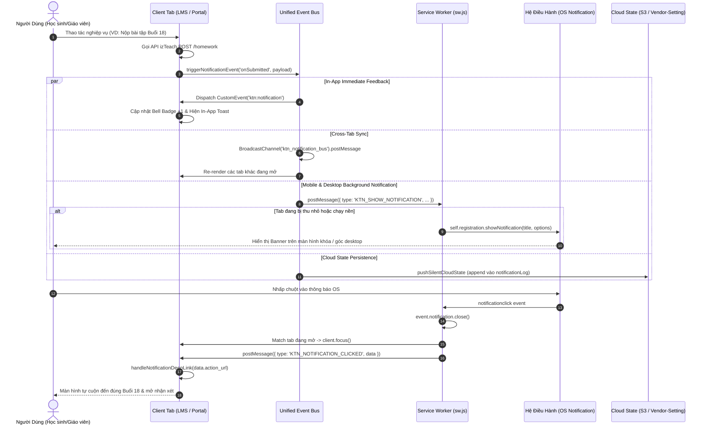
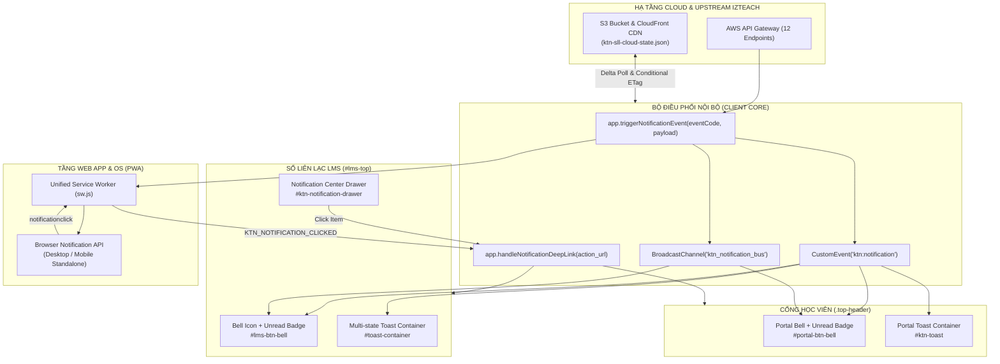

# ĐẶC TẢ KỸ THUẬT TOÀN DIỆN HỆ THỐNG THÔNG BÁO (NOTIFICATION SYSTEM SPECIFICATION)
## Hệ Sinh Thái Sổ Liên Lạc LMS & Cổng Học Viên Trực Tuyến Khổng Tử Nhí (`khongtunhi.com`)

> **Tài liệu đặc tả chuẩn sản xuất (Production-Grade Specification Document)**  
> **Phiên bản:** 1.0.0 — Bản hoàn thiện kỹ thuật  
> **Ngày phê chuẩn:** 2026-11-01  
> **Phạm vi áp dụng:** Sổ Liên Lạc LMS (`so-lien-lac.html`, `so-lien-lac-lms.js`, `so-lien-lac-ux.js`), Cổng Học Viên Trực Tuyến (`portal_template.html`), Service Worker (`sw.js`), và Cụm API Gateway izTeach AWS Serverless.

---

## MỤC LỤC
1. [TỔNG QUAN HỆ THỐNG VÀ KIẾN TRÚC MỤC TIÊU](#1-tổng-quan-hệ-thống-và-kiến-trúc-mục-tiêu)
2. [MA TRẬN KỊCH BẢN THÔNG BÁO CHI TIẾT THEO VAI TRÒ (NOTIFICATION SCENARIOS MATRIX)](#2-ma-trận-kịch-bản-thông-báo-chi-tiết-theo-vai-trò)
   - [2.1. Nhóm 1: Học tập & Bài tập (Academic & Homework)](#21-nhóm-1-học-tập--bài-tập-academic--homework)
   - [2.2. Nhóm 2: Giao tiếp & Tin nhắn (Communication & Chat)](#22-nhóm-2-giao-tiếp--tin-nhắn-communication--chat)
   - [2.3. Nhóm 3: Lịch học & Vận hành (Schedule & Operations)](#23-nhóm-3-lịch-học--vận-hành-schedule--operations)
   - [2.4. Nhóm 4: Tuyển sinh & Đơn hàng (Enrollment & Orders)](#24-nhóm-4-tuyển-sinh--đơn-hàng-enrollment--orders)
   - [2.5. Nhóm 5: An toàn & Kiểm soát (Security, DLP & Audit)](#25-nhóm-5-an-toàn--kiểm-soát-security-dlp--audit)
3. [THIẾT KẾ LUỒNG TRUYỀN TẢI CHUẨN PWA & TRẢI NGHIỆM GIAO DIỆN (PWA & UX FLOWS)](#3-thiết-kế-luồng-truyền-tải-chuẩn-pwa--trải-nghiệm-giao-diện)
   - [3.1. Chuông thông báo (Bell Icon) & Huy hiệu đếm chưa đọc (Unread Badge)](#31-chuông-thông-báo-bell-icon--huy-hiệu-đếm-chưa-đọc-unread-badge)
   - [3.2. Trung tâm thông báo (Notification Center Drawer / Dropdown)](#32-trung-tâm-thông-báo-notification-center-drawer--dropdown)
   - [3.3. Hệ thống Toast thông báo nổi đa trạng thái (In-App Toast System)](#33-hệ-thống-toast-thông-báo-nổi-đa-trạng-thái-in-app-toast-system)
   - [3.4. Chuẩn hóa PWA & Web Push Notification](#34-chuẩn-hóa-pwa--web-push-notification)
   - [3.5. Sơ đồ luồng & Trình tự (Mermaid Sequence & Architecture Diagrams)](#35-sơ-đồ-luồng--trình-tự-mermaid-diagrams)
4. [KIẾN TRÚC DỮ LIỆU VÀ ĐỒNG BỘ HÓA (DATA SCHEMA & SYNC ARCHITECTURE)](#4-kiến-trúc-dữ-liệu-và-đồng-bộ-hóa-data-schema--sync-architecture)
   - [4.1. Lược đồ JSON Đối tượng Thông báo (Notification Object Schema)](#41-lược-đồ-json-đối-tượng-thông-báo-notification-object-schema)
   - [4.2. Kiến trúc lưu trữ Cloud State S3 & CloudFront CDN](#42-kiến-trúc-lưu-trữ-cloud-state-s3--cloudfront-cdn)
   - [4.3. Kiến trúc Event Bus nội bộ 3 tầng (Unified Notification Bus)](#43-kiến-trúc-event-bus-nội-bộ-3-tầng-unified-notification-bus)
   - [4.4. Chiến lược đồng bộ không xung đột (Conflict-Free Sync Strategy)](#44-chiến-lược-đồng-bộ-không-xung-đột-conflict-free-sync-strategy)
   - [4.5. Phân quyền và Bảo mật đa tầng (RBAC & Multi-layer Isolation)](#45-phân-quyền-và-bảo-mật-đa-tầng-rbac--multi-layer-isolation)
   - [4.6. Tích hợp 12 Endpoint izTeach API & Bản đồ Sự kiện kích hoạt](#46-tích-hợp-12-endpoint-izteach-api--bản-đồ-sự-kiện-kích-hoạt)
5. [LỘ TRÌNH TRIỂN KHAI VÀ BỘ TIÊU CHÍ NGHIỆM THU (ROADMAP & ACCEPTANCE CHECKLIST)](#5-lộ-trình-triển-khai-và-bộ-tiêu-chí-nghiệm-thu)

---

## 1. TỔNG QUAN HỆ THỐNG VÀ KIẾN TRÚC MỤC TIÊU

### 1.1. Bối cảnh và Mục đích
Hệ sinh thái đào tạo tiếng Trung của **Học Viện Khổng Tử Nhí** bao gồm hai giao diện người dùng chính:
1. **Sổ Liên Lạc Điện Tử LMS (`so-lien-lac.html`)**: Phục vụ công tác quản lý của Quản trị viên (`admin`), công tác giảng dạy, chấm bài của Giáo viên (`teacher`), và theo dõi học tập của Phụ huynh học sinh lớp cố định (`parent`).
2. **Cổng Học Viên Trực Tuyến (`portal_template.html` / `demo_hsk1_student_portal.html`)**: Không gian học tập hiện đại, tối ưu trải nghiệm học bài, xem video giáo trình, luyện nghe và nộp bài tập về nhà cho Học viên trực tuyến (`student`).

Hiện tại, các thông báo nghiệp vụ (như nộp bài, chấm bài, duyệt đơn hàng) đã có các điểm gọi (call-sites) trong mã nguồn nhưng đang bị đứt gãy do:
- Hàm điều phối trung tâm `app.triggerNotificationEvent` đang bị stub trả về `false` (`so-lien-lac-ux.js:11754`).
- Cả SLL LMS Topbar (`#lms-top`) và Cổng Học Viên (`.top-header`) đều thiếu biểu tượng Chuông thông báo (Bell Icon), Huy hiệu đếm số chưa đọc (Unread Badge) và Trung tâm thông báo (Notification Center).
- File Service Worker (`sw.js`) bị lệnh hủy đăng ký cưỡng bức trong `ktn_global_auth_hook.js` vô hiệu hóa hoàn toàn.
- Cloud State đang bị gửi nhờ vào trường SEO của API Vendor Setting thay vì lưu trữ độc lập trên hạ tầng S3/CloudFront.

Tài liệu này cung cấp thiết kế kỹ thuật hoàn chỉnh để thiết lập một **Hệ Thống Thông Báo Hợp Nhất (Unified Notification System)**, chuẩn PWA, phân quyền chặt chẽ trên 4 nhóm vai trò, đồng bộ dữ liệu thời gian thực và không xảy ra xung đột.

### 1.2. Các Bên Liên Quan & 4 Vai Trò Người Dùng
Hệ thống quản lý thông báo phục vụ 4 nhóm vai trò (Roles) với phạm vi dữ liệu (Scope) hoàn toàn biệt lập:

| Vai trò (Role) | Mã định danh (`role`) | Đối tượng người dùng | Phạm vi truy cập & Nhận tin (RBAC Scope) | Trọng tâm trải nghiệm thông báo |
|---|---|---|---|---|
| **Quản trị viên** | `admin` (bao gồm cả `root`) | Ban giám đốc, quản lý học viện, điều phối viên tuyển sinh | **Toàn trung tâm (`center`)**: Toàn bộ lớp, toàn bộ học viên, tài chính, đơn hàng, bảo mật DLP | Nhận cảnh báo đơn hàng mới cần duyệt, cảnh báo vi phạm an toàn DLP, báo cáo tiến độ toàn trường. |
| **Giáo viên** | `teacher` | Giáo viên chủ nhiệm, giáo viên bộ môn, trợ giảng | **Phân công (`assigned`)**: Chỉ các lớp (`classIds`) và học viên (`studentIds`) được chỉ định phụ trách | Nhận thông báo khi học sinh nộp bài tập mới, tin nhắn trao đổi trong nhóm lớp, nhắc lịch dạy. |
| **Học viên trực tuyến** | `student` | Học viên tự học các khóa học online (New HSK 1, 3.0, YCT) | **Cá nhân (`self`)**: Chỉ nhận dữ liệu của chính tài khoản (`userId === principal.account.id`) | Nhận kết quả chấm bài & nhận xét của cô giáo, thông báo kích hoạt khóa học mới, nhắc làm bài tập. |
| **Phụ huynh / Học viên lớp cố định** | `parent` | Phụ huynh theo dõi con học các lớp Zoom/Offline cố định | **Cá nhân / Gia đình (`self`)**: Chỉ nhận dữ liệu thuộc mã học viên của con (`studentCode`) | Nhận kết quả chấm bài của con, nhắc lịch vào lớp trước 30 phút, nhận xét của giáo viên, tin nhắn lớp. |

### 1.3. Mô Hình Đa Tầng (Unified Multi-Tier Notification Bus)
Để đảm bảo thông báo luôn được gửi đến người dùng bất kể trạng thái ứng dụng (đang mở tab, đang ẩn tab ở background, mở nhiều tab cùng lúc, hay đã đóng trình duyệt), hệ thống vận hành theo kiến trúc 4 tầng truyền tải:

```
[SỰ KIỆN NGHIỆP VỤ (Trigger Events)]
  ├─ Học sinh nộp bài tập (POST /homework)
  ├─ Giáo viên chấm điểm (POST /homework approved)
  ├─ Học viên đăng ký khóa học (POST /student)
  ├─ Admin duyệt đơn hàng (PUT /add-products)
  └─ Vi phạm DLP trong chat (KTN_DLP.inspect)
               │
               ▼
   [app.triggerNotificationEvent]
               │
   ┌───────────┼───────────┬───────────┐
   │           │           │           │
   ▼           ▼           ▼           ▼
[TẦNG 1]    [TẦNG 2]    [TẦNG 3]    [TẦNG 4]
Local In-App  Cross-Tab   Background   Cloud State
CustomEvent   Broadcast   Service      S3/CloudFront
 (0ms Tab)    Channel     Worker       (Delta Poll)
   │           │           │           │
   ▼           ▼           ▼           ▼
UI Bell     Sync All    OS Native   Cross-Device
Toast Box   Open Tabs   Mobile Push Sync History
```

1. **Tầng 1 — Local In-App Dispatch (`CustomEvent('ktn:notification')`)**: Độ trễ 0ms, cập nhật ngay lập tức Bell Icon, Badge và Toast nổi trên tab hiện hành.
2. **Tầng 2 — Cross-Tab Synchronization (`BroadcastChannel('ktn_notification_bus')`)**: Đồng bộ trạng thái tức thì giữa tất cả các tab đang mở cùng origin (ví dụ: mở đồng thời SLL LMS và Cổng học viên).
3. **Tầng 3 — Background PWA & Web Push (`sw.js` + Web Notification API)**: Hiển thị thông báo ngoài màn hình hệ điều hành (Windows/Android/macOS/iOS Standalone) ngay cả khi ứng dụng đang chạy nền.
4. **Tầng 4 — Cloud Persistence (`ktn-sll-cloud-state.json` trên S3/CloudFront)**: Lưu trữ lịch sử thông báo vào `notificationLog`, cho phép đồng bộ xuyên thiết bị (học trên điện thoại, đăng nhập máy tính vẫn xem được lịch sử).

---

## 2. MA TRẬN KỊCH BẢN THÔNG BÁO CHI TIẾT THEO VAI TRÒ

Mỗi kịch bản thông báo trong hệ sinh thái bắt buộc phải định nghĩa đầy đủ **7 trường dữ liệu chuẩn**:
1. **Tên kịch bản (Scenario Name)**: Tên mô tả nghiệp vụ trực quan.
2. **Mã sự kiện kích hoạt (Event Type / Trigger)**: Chuỗi định danh sự kiện độc nhất.
3. **Bên gửi (Sender Role / System)**: Nguồn phát sinh thông báo.
4. **Bên nhận (Recipient Role / Target Scope)**: Vai trò và phạm vi người nhận.
5. **Tiêu đề & Mẫu nội dung (Title & Body Template)**: Cấu trúc văn bản chứa các biến động `{...}`.
6. **Mức độ ưu tiên (Priority)**: `HIGH` (khẩn cấp/hành động ngay), `MEDIUM` (quan trọng), `LOW` (thông tin).
7. **Hành vi điều hướng khi nhấp chuột (Action Deep-link & Internal Handler)**: URL đích kèm hàm router nội bộ. Toàn bộ các thao tác điều hướng deep-link bắt buộc phải đi qua middleware `app.guardDeepLinkNavigation` để kiểm tra phiên đăng nhập, bảo tồn ý định trong `sessionStorage.ktn_pending_redirect`, và bảo vệ chuyển vai trò qua `app.switchRoleSafe`.

---

### 2.1. Nhóm 1: Học tập & Bài tập (Academic & Homework)

#### Kịch bản SCN-ACAD-01: Giao bài tập mới (Lớp học cố định)
- **Mã sự kiện kích hoạt**: `HOMEWORK_ASSIGNED`
- **Bên gửi**: `teacher` (hoặc `admin`)
- **Bên nhận**: `student`, `parent` thuộc `classCode === {classCode}`
- **Tiêu đề mẫu**: `📚 Bài tập mới: {lessonTitle} — Lớp {classCode}`
- **Nội dung mẫu**: `Cô {teacherName} vừa giao bài tập Buổi {lessonNum} cho lớp mình. Hạn hoàn thành: {dueDate}. Các con cùng luyện tập và nộp bài đúng hạn nhé!`
- **Mức độ ưu tiên**: `HIGH`
- **Hành vi điều hướng**:
  - *Action Deep-link*: `/custom-page/so-lien-lac-v1?tab=homework&lesson={lessonNum}&classCode={classCode}`
  - *Internal Handler (SLL LMS)*: `app.guardDeepLinkNavigation('/custom-page/so-lien-lac-v1?tab=homework&lesson={lessonNum}&classCode={classCode}'); app.switchRoleSafe('parent'); app.switchParentSubtab('homework'); app.selectParentLesson({lessonNum});`
  - *Internal Handler (Portal)*: `window.enterCourseLearning('{courseId}'); window.loadLesson({lessonIndex});`

#### Kịch bản SCN-ACAD-02: Nhắc hạn nộp bài tập (Trước 24h và trước 2h)
- **Mã sự kiện kích hoạt**: `HOMEWORK_DUE_REMINDER`
- **Bên gửi**: `SYSTEM` (Bộ lập lịch Cloud State / Client Timer)
- **Bên nhận**: `student`, `parent` có trạng thái bài tập `status === 'PENDING'` hoặc `unsubmitted`
- **Tiêu đề mẫu**: `⏰ Nhắc hạn nộp bài: Buổi {lessonNum} sắp hết hạn!`
- **Nội dung mẫu**: `Bé {studentName} ơi, bài tập "{lessonTitle}" sẽ hết hạn nộp vào lúc {dueTime}. Hãy hoàn thành bài chụp vở/ghi âm để cô giáo kịp chấm nhé!`
- **Mức độ ưu tiên**: `HIGH`
- **Hành vi điều hướng**:
  - *Action Deep-link*: `/custom-page/so-lien-lac-v1?tab=homework&lesson={lessonNum}`
  - *Internal Handler*: `app.guardDeepLinkNavigation('/custom-page/so-lien-lac-v1?tab=homework&lesson={lessonNum}'); app.switchRoleSafe('parent'); app.switchParentSubtab('homework'); app.selectParentLesson({lessonNum});`

#### Kịch bản SCN-ACAD-03: Xác nhận nộp bài tập thành công
- **Mã sự kiện kích hoạt**: `HOMEWORK_SUBMITTED_CONFIRM`
- **Bên gửi**: `SYSTEM` (Sau khi gọi thành công `POST /homework` lên izTeach)
- **Bên nhận**: `student`, `parent` (chính người nộp bài)
- **Tiêu đề mẫu**: `🎉 Nộp bài thành công: Buổi {lessonNum} — {lessonTitle}`
- **Nội dung mẫu**: `Hệ thống đã nhận {fileCount} tệp bài làm của con lúc {submitTime}. Bài làm đã được chuyển đến cô {teacherName} để chấm điểm.`
- **Mức độ ưu tiên**: `MEDIUM`
- **Hành vi điều hướng**:
  - *Action Deep-link*: `/custom-page/student-portal-test?course={courseId}&lesson={lessonIndex}&tab=homework`
  - *Internal Handler*: `window.loadLesson({lessonIndex}); window.showToast('Bài nộp đã được ghi nhận trên hệ thống!', 'success');`

#### Kịch bản SCN-ACAD-04: Giáo viên chấm điểm và nhận xét bài tập
- **Mã sự kiện kích hoạt**: `HOMEWORK_GRADED`
- **Bên gửi**: `teacher` (hoặc `admin` qua `app.lmsGo('grade')` / `app.lmsGo('course-grade')`)
- **Bên nhận**: `student`, `parent` có `studentId === {studentId}`
- **Tiêu đề mẫu**: `👩‍🏫 Cô giáo đã chấm bài: Buổi {lessonNum} — Điểm: {mark}/10`
- **Nội dung mẫu**: `Cô {teacherName} vừa nhận xét bài của bé {studentName}: "{teacherNotes}". Chúc mừng con đã hoàn thành xuất sắc!`
- **Mức độ ưu tiên**: `HIGH`
- **Hành vi điều hướng**:
  - *Action Deep-link*: `/custom-page/so-lien-lac-v1?tab=homework&lesson={lessonNum}&hwId={homeworkId}`
  - *Internal Handler (SLL LMS)*: `app.guardDeepLinkNavigation('/custom-page/so-lien-lac-v1?tab=homework&lesson={lessonNum}&hwId={homeworkId}'); app.switchRoleSafe('parent'); app.switchParentSubtab('homework'); app.selectParentLesson({lessonNum});`
  - *Internal Handler (Portal)*: `window.loadLesson({lessonIndex}); window.showGradedModal('{homeworkId}');`

#### Kịch bản SCN-ACAD-05: Bài nộp mới cần chấm (Dành cho Giáo viên & Quản lý)
- **Mã sự kiện kích hoạt**: `HOMEWORK_SUBMITTED_TEACHER_ALERT`
- **Bên gửi**: `student` (sau khi hoàn thành bài nộp)
- **Bên nhận**: `teacher` phụ trách lớp (đối với lớp cố định) hoặc `admin` & giáo viên trực (đối với khóa học online tự do)
- **Tiêu đề mẫu**: `📥 Bài nộp mới: {studentName} ({classCode}) — Buổi {lessonNum}`
- **Nội dung mẫu**: `Học viên {studentName} vừa nộp {fileCount} tệp bài tập cho bài "{lessonTitle}". Vui lòng kiểm tra và gửi nhận xét cho con.`
- **Mức độ ưu tiên**: `MEDIUM`
- **Hành vi điều hướng**:
  - *Action Deep-link (Lớp cố định)*: `/custom-page/so-lien-lac-v1?view=grade&classCode={classCode}&lesson={lessonNum}`
  - *Action Deep-link (Khóa tự học)*: `/custom-page/so-lien-lac-v1?view=course-grade&course={courseId}&studentId={studentId}`
  - *Internal Handler*: `app.lmsGo(isCourseGrade ? 'course-grade' : 'grade', { hwClass: '{classCode}', hwTab: 'pending' });`

#### Kịch bản SCN-ACAD-06: Hoàn thành bài học / Mini-Game YCT
- **Mã sự kiện kích hoạt**: `LESSON_COMPLETED`
- **Bên gửi**: `SYSTEM` (Khi học sinh đạt 100% video hoặc vượt qua Mini-Game)
- **Bên nhận**: `student`, `parent`
- **Tiêu đề mẫu**: `⭐ Chúc mừng con đã hoàn thành: {lessonTitle}!`
- **Nội dung mẫu**: `Bé {studentName} đã xuất sắc hoàn thành nội dung bài học và đạt danh hiệu "{achievementTitle}". Trạng thái bài học đã chuyển sang màu xanh lá.`
- **Mức độ ưu tiên**: `LOW`
- **Hành vi điều hướng**:
  - *Action Deep-link*: `/custom-page/student-portal-test?course={courseId}&lesson={lessonIndex}`
  - *Internal Handler*: `window.enterCourseLearning('{courseId}'); window.loadLesson({lessonIndex});`

---

### 2.2. Nhóm 2: Giao tiếp & Tin nhắn (Communication & Chat)

#### Kịch bản SCN-COMM-01: Tin nhắn trực tiếp mới từ Phụ huynh / Giáo viên
- **Mã sự kiện kích hoạt**: `DIRECT_CHAT_MESSAGE`
- **Bên gửi**: `teacher` (gửi cho phụ huynh) hoặc `parent` (gửi cho giáo viên)
- **Bên nhận**: `parent` (hoặc `teacher`) có `recipientId === {recipientId}`
- **Tiêu đề mẫu**: `💬 Tin nhắn mới từ {senderName} ({senderRoleLabel})`
- **Nội dung mẫu**: `"{snippetText}"` (văn bản đã qua bộ lọc DLP, cắt ngắn tối đa 80 ký tự).
- **Mức độ ưu tiên**: `HIGH`
- **Hành vi điều hướng**:
  - *Action Deep-link*: `/custom-page/so-lien-lac-v1?tab=chat&partnerId={senderId}`
  - *Internal Handler*: `app.guardDeepLinkNavigation('/custom-page/so-lien-lac-v1?tab=chat&partnerId={senderId}'); app.switchRoleSafe(userRole); app.openDirectChat('{senderId}');`

#### Kịch bản SCN-COMM-02: Tin nhắn mới trong phòng chat nhóm lớp
- **Mã sự kiện kích hoạt**: `CLASS_CHAT_MESSAGE`
- **Bên gửi**: Thành viên lớp (`teacher`, `parent`, `student`, `admin`)
- **Bên nhận**: Toàn bộ thành viên còn lại trong lớp (`classCode === {classCode}`, ngoại trừ người gửi)
- **Tiêu đề mẫu**: `💬 Lớp {classCode}: Tin nhắn mới từ {senderName}`
- **Nội dung mẫu**: `"{snippetText}"`
- **Mức độ ưu tiên**: `MEDIUM`
- **Hành vi điều hướng**:
  - *Action Deep-link*: `/custom-page/so-lien-lac-v1?view=groups&room={classCode}`
  - *Internal Handler*: `app.lmsGo('groups', { room: '{classCode}' });`

#### Kịch bản SCN-COMM-03: Thông báo ghim (Announcement) của Quản trị viên
- **Mã sự kiện kích hoạt**: `CENTER_ANNOUNCEMENT`
- **Bên gửi**: `admin`
- **Bên nhận**: Toàn bộ người dùng (`ALL_USERS` hoặc theo nhóm vai trò được chọn)
- **Tiêu đề mẫu**: `📢 Thông báo từ Học Viện: {announcementTitle}`
- **Nội dung mẫu**: `{announcementBody}`
- **Mức độ ưu tiên**: `HIGH`
- **Hành vi điều hướng**:
  - *Action Deep-link*: `/custom-page/so-lien-lac-v1?view=announcements&id={announcementId}`
  - *Internal Handler*: `app.showAnnouncementModal('{announcementId}');`

---

### 2.3. Nhóm 3: Lịch học & Vận hành (Schedule & Operations)

#### Kịch bản SCN-SCHED-01: Nhắc giờ vào lớp học trước 30 phút
- **Mã sự kiện kích hoạt**: `CLASS_STARTING_SOON`
- **Bên gửi**: `SYSTEM` (Đếm ngược tự động dựa trên thời khóa biểu `classSchedule`)
- **Bên nhận**: `teacher`, `student`, `parent` thuộc `classCode === {classCode}`
- **Tiêu đề mẫu**: `🔔 Sắp đến giờ học: Lớp {classCode} (30 phút nữa)`
- **Nội dung mẫu**: `Buổi học "{lessonTitle}" sẽ bắt đầu lúc {startTime}. Phòng học: {roomOrZoomLink}. Bố mẹ hãy chuẩn bị sách vở và thiết bị cho bé nhé!`
- **Mức độ ưu tiên**: `HIGH`
- **Hành vi điều hướng**:
  - *Action Deep-link*: `/custom-page/so-lien-lac-v1?tab=schedule&classCode={classCode}`
  - *Internal Handler*: `app.openClassRoomQuickLink('{classCode}');`

#### Kịch bản SCN-SCHED-02: Thông báo thay đổi lịch học / bù giờ / nghỉ học
- **Mã sự kiện kích hoạt**: `SCHEDULE_CHANGE_ALERT`
- **Bên gửi**: `admin` hoặc `teacher`
- **Bên nhận**: `student`, `parent` thuộc `classCode === {classCode}`
- **Tiêu đề mẫu**: `⚠️ Thay đổi lịch học: Lớp {classCode}`
- **Nội dung mẫu**: `Lịch học ngày {oldDate} được dời sang ngày {newDate} ({newTime}) do {reason}. Kính mời quý phụ huynh lưu ý.`
- **Mức độ ưu tiên**: `HIGH`
- **Hành vi điều hướng**:
  - *Action Deep-link*: `/custom-page/so-lien-lac-v1?tab=schedule&classCode={classCode}`
  - *Internal Handler*: `app.lmsGo('classes', { clsId: '{classCode}', clsTab: 'schedule' });`

#### Kịch bản SCN-SCHED-03: Thay đổi phòng học hoặc liên kết Zoom
- **Mã sự kiện kích hoạt**: `CLASS_ROOM_UPDATED`
- **Bên gửi**: `admin` hoặc `teacher`
- **Bên nhận**: `student`, `parent`, `teacher` thuộc `classCode === {classCode}`
- **Tiêu đề mẫu**: `🔄 Cập nhật link phòng học: Lớp {classCode}`
- **Nội dung mẫu**: `Link phòng học trực tuyến mới: {zoomLink} (Mật khẩu: {zoomPass}). Quý phụ huynh vui lòng cập nhật để vào lớp đúng giờ.`
- **Mức độ ưu tiên**: `HIGH`
- **Hành vi điều hướng**:
  - *Action Deep-link*: `/custom-page/so-lien-lac-v1?tab=schedule&classCode={classCode}`
  - *Internal Handler*: `app.openClassRoomQuickLink('{classCode}');`

---

### 2.4. Nhóm 4: Tuyển sinh & Đơn hàng (Enrollment & Orders)

#### Kịch bản SCN-ORD-01: Người dùng mới đăng ký khóa học Online
- **Mã sự kiện kích hoạt**: `ORDER_CREATED`
- **Bên gửi**: `student` / Khách vãng lai (qua Form đăng ký Portal hoặc quét VietQR)
- **Bên nhận**: `admin` (Quản trị viên trung tâm)
- **Tiêu đề mẫu**: `🛒 Đơn đăng ký mới: {courseName} — {studentName}`
- **Nội dung mẫu**: `Khách hàng {studentName} ({email} · {phone}) vừa đăng ký khóa học {courseName}. Mã đơn: #{orderCode}. Số tiền: {amountFormatted}đ.`
- **Mức độ ưu tiên**: `HIGH`
- **Hành vi điều hướng**:
  - *Action Deep-link*: `/custom-page/so-lien-lac-v1?view=orders&orderId={orderId}`
  - *Internal Handler*: `app.lmsGo('orders', { filterOrder: '{orderId}' });`

#### Kịch bản SCN-ORD-02: Quản trị viên duyệt đơn hàng 1-chạm thành công
- **Mã sự kiện kích hoạt**: `ORDER_APPROVED`
- **Bên gửi**: `admin` (khi bấm nút "Duyệt 1 chạm" `app.oneClickApproveOrder`)
- **Bên nhận**: `student`, `parent` (theo email người mua)
- **Tiêu đề mẫu**: `✅ Đăng ký thành công: Khóa học {courseName}!`
- **Nội dung mẫu**: `Học Viện Khổng Tử Nhí đã kích hoạt khóa học {courseName} cho bạn. Tài khoản đăng nhập: {email}. Bấm vào để bắt đầu học ngay!`
- **Mức độ ưu tiên**: `HIGH`
- **Hành vi điều hướng**:
  - *Action Deep-link*: `/custom-page/student-portal-test?course={courseId}` *(Đã loại bỏ hoàn toàn tham số `autoLogin=1` nhằm khắc phục dứt điểm lỗ hổng bảo mật VULN-11. Nếu cần cơ chế đăng nhập 1 chạm từ Email/SMS, hệ thống sử dụng vé bảo mật một lần One-Time Ticket HMAC: `ott={signed_jwt_token}&exp={ttl}` có thời hạn tối đa 300s và vô hiệu hóa ngay sau khi đổi session token)*
  - *Internal Handler*: `app.guardDeepLinkNavigation('/custom-page/student-portal-test?course={courseId}'); window.enterCourseLearning('{courseId}'); window.showToast('Chào mừng bạn đến với khóa học!', 'success');`

#### Kịch bản SCN-ORD-03: Kích hoạt quyền khóa học tự động (Course Entitlement Provisioned)
- **Mã sự kiện kích hoạt**: `COURSE_PROVISIONED`
- **Bên gửi**: `SYSTEM` (sau khi gọi thành công `PUT /add-products/:userId` trên gateway `vs1ocpw7ri`)
- **Bên nhận**: `student` (`userId === {userId}`)
- **Tiêu đề mẫu**: `🎓 Bạn đã được cấp quyền truy cập: {courseName}`
- **Nội dung mẫu**: `Toàn bộ 31 bài học, video bài giảng chuẩn HLS và kho giáo trình PDF của khóa học {courseName} đã sẵn sàng trong tài khoản của bạn.`
- **Mức độ ưu tiên**: `MEDIUM`
- **Hành vi điều hướng**:
  - *Action Deep-link*: `/custom-page/student-portal-test?course={courseId}`
  - *Internal Handler*: `window.enterCourseLearning('{courseId}');`

#### Kịch bản SCN-ORD-04: Đơn hàng duyệt thất bại / Cần can thiệp thủ công
- **Mã sự kiện kích hoạt**: `ORDER_APPROVAL_FAILED`
- **Bên gửi**: `SYSTEM` (khi CRM hoặc API `add-products` trả về lỗi ngoại trừ `is existed`)
- **Bên nhận**: `admin`
- **Tiêu đề mẫu**: `❌ Lỗi cấp quyền đơn hàng #{orderCode}`
- **Nội dung mẫu**: `Không thể tự động cấp quyền khóa học cho đơn hàng #{orderCode} ({email}): {errorMessage}. Vui lòng bấm vào để kiểm tra và thử lại 1 chạm.`
- **Mức độ ưu tiên**: `HIGH`
- **Hành vi điều hướng**:
  - *Action Deep-link*: `/custom-page/so-lien-lac-v1?view=orders&orderId={orderId}`
  - *Internal Handler*: `app.lmsGo('orders', { filterOrder: '{orderId}' });`

---

### 2.5. Nhóm 5: An toàn & Kiểm soát (Security, DLP & Audit)

#### Kịch bản SCN-SEC-01: Cảnh báo vi phạm DLP (Số điện thoại, Zalo, Rủ học riêng)
- **Mã sự kiện kích hoạt**: `DLP_VIOLATION_ALERT`
- **Bên gửi**: `SYSTEM` (`window.KTN_DLP.inspect`)
- **Bên nhận**: `admin` (Độc quyền Quản trị viên)
- **Tiêu đề mẫu**: `🚨 Cảnh báo DLP: Phát hiện thông tin liên lạc ngoài hệ thống`
- **Nội dung mẫu**: `Người dùng {senderName} ({senderEmail} · Vai trò: {senderRole}) trong phòng {contextRoom} vừa gửi nội dung có dấu hiệu vi phạm: "{matchedReason}". Tin nhắn đã bị chặn tự động.`
- **Mức độ ưu tiên**: `HIGH`
- **Hành vi điều hướng**:
  - *Action Deep-link*: `/custom-page/so-lien-lac-v1?view=alerts&alertId={alertId}`
  - *Internal Handler*: `app.lmsGo('alerts', { filterAlert: '{alertId}' });`

#### Kịch bản SCN-SEC-02: Cảnh báo truy cập trái phép phòng học (Cross-Class Access Denied)
- **Mã sự kiện kích hoạt**: `CROSS_CLASS_FORBIDDEN_ALERT`
- **Bên gửi**: `SYSTEM` (WebSocket Gateway `so-lien-lac-server.cjs`)
- **Bên nhận**: `admin`
- **Tiêu đề mẫu**: `🛡️ Cảnh báo bảo mật: Cố ý truy cập trái phép phòng học`
- **Nội dung mẫu**: `Học sinh {studentName} (Lớp: {ownClassCode}) cố gắng kết nối vào phòng chat lớp {targetClassCode}. Hệ thống đã chặn với mã lỗi 403.`
- **Mức độ ưu tiên**: `HIGH`
- **Hành vi điều hướng**:
  - *Action Deep-link*: `/custom-page/so-lien-lac-v1?view=alerts&type=security`
  - *Internal Handler*: `app.lmsGo('alerts');`

#### Kịch bản SCN-SEC-03: Cảnh báo phiên đăng nhập hết hạn / Xung đột token
- **Mã sự kiện kích hoạt**: `SESSION_EXPIRED_ALERT`
- **Bên gửi**: `SYSTEM` (Khi nhận phản hồi 401 Unauthorized từ izTeach API)
- **Bên nhận**: Người dùng hiện tại (`CURRENT_USER`)
- **Tiêu đề mẫu**: `⚠️ Phiên làm việc đã hết hạn`
- **Nội dung mẫu**: `Phiên đăng nhập của bạn đã hết hạn bảo mật. Vui lòng đăng nhập lại để tiếp tục học tập và làm bài tập.`
- **Mức độ ưu tiên**: `HIGH`
- **Hành vi điều hướng**:
  - *Action Deep-link*: `/custom-page/so-lien-lac-v1?action=relogin`
  - *Internal Handler*: `app.promptSessionRenewal();`

---

## 3. THIẾT KẾ LUỒNG TRUYỀN TẢI CHUẨN PWA & TRẢI NGHIỆM GIAO DIỆN (PWA & UX FLOWS)

### 3.1. Chuông Thông Báo (Bell Icon) & Huy Hiệu Đếm Chưa Đọc (Unread Badge)

#### A. Vị trí trên SLL LMS Topbar (`#lms-top` trong `so-lien-lac-lms.js`)
Trong hàm `renderTop(r, page)` tại dòng 764 của `so-lien-lac-lms.js`, nút Chuông thông báo được tích hợp trực tiếp vào cụm tác vụ `.lms-top-act` ngay trước nút Profile cá nhân:

```javascript
// ĐIỂM GẮN NEO CHUÔNG THÔNG BÁO TRÊN TOPBAR SLL LMS (so-lien-lac-lms.js:764)
const bellBtn = `
  <button type="button" class="ktn-bell-btn lms-bell-btn" id="ktn-bell-trigger" onclick="(window.KTN_NOTIF||window.app).toggleNotificationCenter()" title="Trung tâm thông báo" aria-label="Xem thông báo mới">
    <svg class="ktn-bell-icon lms-bell-icon" width="20" height="20" viewBox="0 0 24 24" fill="none" stroke="currentColor" stroke-width="2" stroke-linecap="round" stroke-linejoin="round">
      <path d="M18 8A6 6 0 0 0 6 8c0 7-3 9-3 9h18s-3-2-3-9"></path>
      <path d="M13.73 21a2 2 0 0 1-3.46 0"></path>
    </svg>
    <span class="ktn-unread-badge lms-bell-badge" id="ktn-unread-count" style="display:none;">0</span>
  </button>
`;
const userBtn = `
  <div class="lms-top-act">
    ${bellBtn}
    <button type="button" class="lms-top-profile" onclick="app.lmsOpenProfile()" title="Tài khoản cá nhân: ${esc(u.name)}">
      <span class="lms-top-av">${esc(initials(u.name))}</span>
      <span class="lms-top-name">${esc(u.name)}</span>
    </button>
  </div>
`;
```

#### B. Vị trí trên Cổng Học Viên (`.top-header` trong `portal_template.html`)
Tại dòng 1533 trong `.header-inner` của `portal_template.html`, nhúng nút Chuông vào vùng hành động bên phải `.header-right-actions` ngay trước cụm `#ktn-user-badge`:

```html
<!-- ĐIỂM GẮN NEO CHUÔNG THÔNG BÁO TRÊN CỔNG HỌC VIÊN (portal_template.html:1533) -->
<div class="header-right-actions" style="display:flex;align-items:center;gap:12px;">
  <button type="button" class="ktn-bell-btn portal-bell-btn" id="ktn-portal-bell-trigger" onclick="(window.KTN_NOTIF||window.app).toggleNotificationCenter()" title="Trung tâm thông báo" aria-label="Thông báo học viên">
    <svg class="ktn-bell-icon portal-bell-icon" width="22" height="22" viewBox="0 0 24 24" fill="none" stroke="currentColor" stroke-width="2" stroke-linecap="round" stroke-linejoin="round">
      <path d="M18 8A6 6 0 0 0 6 8c0 7-3 9-3 9h18s-3-2-3-9"></path>
      <path d="M13.73 21a2 2 0 0 1-3.46 0"></path>
    </svg>
    <span class="ktn-unread-badge portal-bell-badge" id="ktn-portal-unread-count" style="display:none;">0</span>
  </button>
  <!-- DYNAMIC REAL USER AUTHENTICATION BADGE -->
  <div class="user-badge" id="ktn-user-badge"></div>
</div>
```

#### C. Quy tắc Hiển thị Trạng thái của Huy hiệu Unread Badge
- **Trạng thái Ẩn (`hidden`)**: Khi số đếm thông báo chưa đọc = `0`. Thẻ `<span>` được thêm class `hidden` (`display: none;`).
- **Trạng thái Đếm số (`1` đến `99`)**: Hiển thị số lượng chính xác với nền đỏ thương hiệu `#EF4444`, viền trắng 1.5px, chữ số trắng đậm, bo tròn hoàn toàn (`border-radius: 9999px`).
- **Trạng thái Tràn số (`> 99`)**: Tự động hiển thị chuỗi `"99+"`.
- **Hiệu ứng Nhịp đập (Pulse Animation)**: Khi có thông báo mới thuộc diện ưu tiên `HIGH` hoặc `MEDIUM`, badge kích hoạt animation `ktn-badge-pulse` phóng to nhẹ 1.25x và tỏa sáng vòng tròn ngoài trong 2.5 giây để thu hút sự chú ý.

```css
/* CSS QUY CHUẨN CHO UNREAD BADGE */
.lms-bell-btn, .portal-bell-btn {
  position: relative;
  background: transparent;
  border: 1px solid #e2e8f0;
  border-radius: 10px;
  width: 40px;
  height: 40px;
  display: flex;
  align-items: center;
  justify-content: center;
  cursor: pointer;
  color: #475569;
  transition: all 0.2s ease;
}
.lms-bell-btn:hover, .portal-bell-btn:hover {
  background: #f1f5f9;
  color: #0f172a;
  border-color: #cbd5e1;
}
.lms-bell-badge, .portal-bell-badge {
  position: absolute;
  top: -4px;
  right: -4px;
  min-width: 18px;
  height: 18px;
  padding: 0 4px;
  background: #ef4444;
  color: #ffffff;
  font-size: 11px;
  font-weight: 700;
  line-height: 18px;
  border-radius: 9999px;
  text-align: center;
  border: 2px solid #ffffff;
  box-shadow: 0 2px 4px rgba(239, 68, 68, 0.35);
  pointer-events: none;
}
.lms-bell-badge.hidden, .portal-bell-badge.hidden {
  display: none !important;
}
@keyframes ktn-badge-pulse {
  0% { transform: scale(1); box-shadow: 0 0 0 0 rgba(239, 68, 68, 0.7); }
  50% { transform: scale(1.2); box-shadow: 0 0 0 6px rgba(239, 68, 68, 0); }
  100% { transform: scale(1); box-shadow: 0 0 0 0 rgba(239, 68, 68, 0); }
}
.badge-pulse {
  animation: ktn-badge-pulse 1.2s infinite ease-in-out;
}
```

---

### 3.2. Trung Tâm Thông Báo (Notification Center Drawer / Dropdown)

Khi người dùng nhấp vào Bell Icon, hệ thống mở một Drawer trượt từ cạnh phải (trên Mobile) hoặc Dropdown menu neo dưới chuông (trên Desktop).

#### A. Cấu trúc DOM Chuẩn
```html
<div id="ktn-notification-drawer" class="ktn-notif-drawer hidden">
  <div class="ktn-notif-backdrop" onclick="(window.KTN_NOTIF||window.app).closeNotificationCenter()"></div>
  <aside class="ktn-notif-panel">
    <!-- HEADER -->
    <header class="ktn-notif-header">
      <div class="ktn-notif-title-wrap">
        <h3 class="ktn-notif-title">Thông Báo</h3>
        <span id="ktn-notif-total-badge" class="ktn-notif-count-pill">3 mới</span>
      </div>
      <div class="ktn-notif-header-actions">
        <button type="button" class="btn-text-action" onclick="(window.KTN_NOTIF||window.app).markAllNotificationsRead()" title="Đánh dấu tất cả là đã đọc">
          ✓ Đã đọc tất cả
        </button>
        <button type="button" class="btn-icon-close" onclick="(window.KTN_NOTIF||window.app).closeNotificationCenter()" aria-label="Đóng">
          ✕
        </button>
      </div>
    </header>

    <!-- TABS PHÂN LOẠI -->
    <nav class="ktn-notif-tabs">
      <button type="button" class="ktn-tab-item active" data-tab="all" onclick="(window.KTN_NOTIF||window.app).switchNotifTab('all')">Tất cả</button>
      <button type="button" class="ktn-tab-item" data-tab="unread" onclick="(window.KTN_NOTIF||window.app).switchNotifTab('unread')">Chưa đọc</button>
      <button type="button" class="ktn-tab-item" data-tab="academic" onclick="(window.KTN_NOTIF||window.app).switchNotifTab('academic')">Học tập</button>
      <button type="button" class="ktn-tab-item" data-tab="comm_sched" onclick="(window.KTN_NOTIF||window.app).switchNotifTab('comm_sched')">Tin nhắn & Lịch</button>
    </nav>

    <!-- DANH SÁCH CUỘN THÔNG BÁO -->
    <div id="ktn-notif-list" class="ktn-notif-scroll-area">
      <!-- Items rendered dynamically -->
    </div>

    <!-- FOOTER / CÀI ĐẶT PWA -->
    <footer class="ktn-notif-footer">
      <button type="button" class="btn-pwa-push-config" onclick="(window.KTN_NOTIF||window.app).requestNotificationPermissionSafe()">
        🔔 Cài đặt nhận thông báo trên điện thoại (PWA)
      </button>
    </footer>
  </aside>
</div>
```

#### B. Cấu trúc Mỗi Phần Tử Thông Báo (Notification Item Markup)
```html
<div class="ktn-notif-item ${item.read_status ? 'is-read' : 'is-unread'}" onclick="(window.KTN_NOTIF||window.app).handleNotificationItemClick('${item.id}', '${item.action_url}')">
  <div class="ktn-notif-icon-col">
    <span class="ktn-category-avatar cat-${item.category}">
      ${getCategoryIconSvg(item.category)}
    </span>
  </div>
  <div class="ktn-notif-content-col">
    <div class="ktn-notif-row-top">
      <h4 class="ktn-item-title">${escapeHtml(item.title)}</h4>
      <span class="ktn-item-time">${formatRelativeTime(item.timestamp)}</span>
    </div>
    <p class="ktn-item-body">${escapeHtml(item.body)}</p>
    ${!item.read_status ? '<span class="ktn-unread-indicator"></span>' : ''}
  </div>
</div>
```

#### C. Các Trạng thái Rỗng (Empty States)
Khi không có thông báo tương ứng với bộ lọc, hệ thống hiển thị minh họa trực quan:
- **Tab Tất cả rỗng**: Icon chiếc chuông ngủ yên + dòng chữ *"Bạn không có thông báo nào gần đây."*
- **Tab Chưa đọc rỗng**: Dấu tích xanh lớn `✓` + dòng chữ *"Tuyệt vời! Bạn đã đọc hết tất cả thông báo."*
- **Tab Phân loại rỗng**: *"Chưa có thông báo nào trong danh mục này."*

---

### 3.3. Hệ Thống Toast Thông Báo Nổi Đa Trạng Thái (In-App Toast System)

Hệ thống hợp nhất Toast Container trên toàn bộ ứng dụng dựa trên chuẩn `#toast-container` của SLL LMS.

#### A. 4 Trạng thái Trực quan
1. **Thành công (`success`)**: Nền xanh ngọc đậm `#064E3B`, viền `#10B981`, icon `✓`. Dùng khi nộp bài thành công, duyệt đơn thành công, kích hoạt khóa học.
2. **Lỗi (`error`)**: Nền đỏ thẫm `#7F1D1D`, viền `#EF4444`, icon `✕`. Dùng khi mất kết nối mạng, lỗi cấp quyền đơn hàng, tải bài học thất bại.
3. **Cảnh báo (`warning`)**: Nền cam hổ phách `#78350F`, viền `#F59E0B`, icon `⚠️`. Dùng khi nhắc hạn nộp bài, cảnh báo DLP, nhắc lịch học 30 phút.
4. **Thông tin (`info`)**: Nền xanh lam sapphire `#1E3A8A`, viền `#3B82F6`, icon `ℹ`. Dùng cho tin nhắn mới, thông báo chung từ học viện.

#### B. Quy tắc Ứng xử (Behavior Rules)
- **Vị trí**: Cố định góc **Trên - Phải** (`top: 24px, right: 24px`) trên Desktop; góc **Trên - Giữa** (`top: 16px, left: 16px, right: 16px`) trên Mobile.
- **Thời gian tự biến mất**: Mặc định **4500ms** (4.5 giây). Khi người dùng rê chuột (`mouseenter`), bộ đếm thời gian tạm dừng (`clearTimeout`); khi rời chuột (`mouseleave`), bộ đếm tiếp tục tính 2000ms rồi đóng.
- **Tương tác nhấp chuột (Interactive Click Routing)**: Mỗi Toast đi kèm `action_url`. Nếu người dùng nhấp vào hộp Toast, Toast lập tức đóng và gọi `app.handleNotificationDeepLink(action_url)`.
- **Chống tràn DOM (Spam Prevention)**: Container chỉ chứa tối đa 3 Toast cùng lúc. Khi Toast thứ 4 xuất hiện, Toast cũ nhất bị loại bỏ mượt mà với animation `fadeOut`.

---

### 3.4. Chuẩn Hóa PWA, Web Push & Trải Nghiệm iOS Safari Fallback

#### A. Khắc phục triệt để Lỗi Hủy Đăng Ký trong `ktn_global_auth_hook.js`
Trong file `ktn_global_auth_hook.js` và `deploy_so_lien_lac_live.cjs`, đoạn mã unregister phá hoại:
```javascript
// ĐOẠN CODE CŨ GÂY LỖI:
if (navigator.serviceWorker && navigator.serviceWorker.getRegistrations) {
  navigator.serviceWorker.getRegistrations().then(function(rs){
    rs.forEach(function(r){ r.unregister(); });
  });
}
```
**BẮT BUỘC ĐƯỢC THAY THẾ HOÀN TOÀN BẰNG:**
```javascript
// ĐOẠN CODE CHUẨN MỚI: QUẢN LÝ SERVICE WORKER BẰNG CACHE VERSION BUSTER
(function() {
  if ('serviceWorker' in navigator) {
    window.addEventListener('load', function() {
      navigator.serviceWorker.register('/sw.js', { scope: '/' })
        .then(function(reg) {
          console.log('[KTN PWA] Service Worker đăng ký thành công, scope:', reg.scope);
          // Kiểm tra nếu có Service Worker mới đang chờ kích hoạt
          if (reg.waiting) {
            reg.waiting.postMessage({ type: 'SKIP_WAITING' });
          }
        })
        .catch(function(err) {
          console.warn('[KTN PWA] Không thể đăng ký Service Worker:', err);
        });
    });
  }
})();
```

#### B. Bộ Phát Hiện Năng Lực Thiết Bị & Khắc Phục iOS Safari Non-Standalone (`KtnPwaEnv`)
Trên hệ điều hành iOS (kể cả iOS 16.4+ đến iOS 18+), WebKit **vô hiệu hóa hoàn toàn Notification API trong các tab trình duyệt Safari thông thường, Chrome iOS và In-App Webview (Zalo/Facebook)** (`window.Notification === undefined`). Lệnh gọi `Notification.requestPermission()` trực tiếp sẽ gây sập ứng dụng (`TypeError / ReferenceError`). Hệ thống thiết lập bộ phát hiện môi trường và điều phối trải nghiệm chuyên biệt:

```javascript
// TIỆN ÍCH KIỂM TRA NĂNG LỰC PWA TOÀN DIỆN
const KtnPwaEnv = {
  isIOS: function() {
    return /iPad|iPhone|iPod/.test(navigator.userAgent) && !window.MSStream;
  },
  isStandalone: function() {
    return (window.navigator.standalone === true) || 
           (window.matchMedia && window.matchMedia('(display-mode: standalone)').matches);
  },
  supportsNotification: function() {
    return ('Notification' in window && typeof Notification.requestPermission === 'function');
  },
  supportsServiceWorker: function() {
    return ('serviceWorker' in navigator);
  }
};

/**
 * Quy trình yêu cầu cấp quyền an toàn đa tầng (Safe Multi-tier Permission Flow)
 */
app.requestNotificationPermissionSafe = async function() {
  // TRƯỜNG HỢP 1: iOS nhưng CHƯA THÊM RA MÀN HÌNH CHÍNH (Non-standalone)
  if (KtnPwaEnv.isIOS() && !KtnPwaEnv.isStandalone()) {
    console.log('[KTN PWA] Phát hiện iOS Safari tab thông thường -> Hiển thị Modal A2HS');
    app.showAddToHomeScreenModal();
    return 'ios_a2hs_required';
  }

  // TRƯỜNG HỢP 2: Trình duyệt không hỗ trợ Notification API (WebView cổ, Facebook/Zalo In-App)
  if (!KtnPwaEnv.supportsNotification()) {
    console.warn('[KTN PWA] Trình duyệt không hỗ trợ Notification API -> Fallback sang In-App Toast');
    if (typeof app.showToast === 'function') {
      app.showToast('Trình duyệt hiện tại không hỗ trợ thông báo ngoài màn hình. Bạn vẫn nhận thông báo trực tiếp trong ứng dụng.', 'info');
    }
    return 'unsupported';
  }

  // TRƯỜNG HỢP 3: Môi trường hợp lệ (Android Chrome, Desktop, hoặc iOS Standalone PWA)
  try {
    const permission = await Notification.requestPermission();
    if (permission === 'granted') {
      console.log('[KTN PWA] Người dùng đã cấp quyền thông báo');
      if (typeof app.showToast === 'function') {
        app.showToast('✅ Đã bật thông báo thành công!', 'success');
      }
      return 'granted';
    } else {
      console.warn('[KTN PWA] Người dùng từ chối quyền thông báo:', permission);
      return 'denied';
    }
  } catch (err) {
    console.error('[KTN PWA] Lỗi khi yêu cầu cấp quyền:', err);
    return 'error';
  }
};
```

#### C. Giao Diện Hướng Dẫn "Thêm Vào Màn Hình Chính" (A2HS Guide Modal cho iOS)
```javascript
app.showAddToHomeScreenModal = function() {
  const existingModal = document.getElementById('ktn-a2hs-modal');
  if (existingModal) existingModal.remove();

  const modalHtml = `
    <div id="ktn-a2hs-modal" style="position: fixed; inset: 0; background: rgba(0,0,0,0.65); z-index: 99999; display: flex; align-items: flex-end; justify-content: center; backdrop-filter: blur(4px);">
      <div style="background: #ffffff; width: 100%; max-width: 480px; border-radius: 20px 20px 0 0; padding: 24px; box-shadow: 0 -8px 24px rgba(0,0,0,0.15); animation: ktnSlideUp 0.3s ease-out;">
        <div style="text-align: center; margin-bottom: 16px;">
          
          <h3 style="margin: 0; font-size: 18px; font-weight: 700; color: #1e293b;">Bật Thông Báo Trên iPhone / iPad</h3>
          <p style="margin: 6px 0 0; font-size: 13px; color: #64748b;">Để nhận nhắc nhở vào lớp và nhận xét bài tập từ giáo viên, bạn cần cài đặt ứng dụng ra Màn hình chính:</p>
        </div>
        <div style="background: #f8fafc; border: 1px solid #e2e8f0; border-radius: 12px; padding: 14px; margin-bottom: 20px; font-size: 14px; color: #334155;">
          <div style="display: flex; align-items: center; margin-bottom: 10px;">
            <span style="background: #e0f2fe; color: #0284c7; width: 24px; height: 24px; border-radius: 50%; display: inline-flex; align-items: center; justify-content: center; font-weight: 700; margin-right: 10px;">1</span>
            <span>Nhấn vào nút <strong>Chia sẻ</strong> <svg style="display:inline; vertical-align:middle; width:18px; height:18px;" viewBox="0 0 24 24" fill="none" stroke="currentColor" stroke-width="2"><path d="M4 12v8a2 2 0 0 0 2 2h12a2 2 0 0 0 2-2v-8"/><polyline points="16 6 12 2 8 6"/><line x1="12" y1="2" x2="12" y2="15"/></svg> ở thanh dưới cùng Safari.</span>
          </div>
          <div style="display: flex; align-items: center; margin-bottom: 10px;">
            <span style="background: #e0f2fe; color: #0284c7; width: 24px; height: 24px; border-radius: 50%; display: inline-flex; align-items: center; justify-content: center; font-weight: 700; margin-right: 10px;">2</span>
            <span>Cuộn xuống và chọn <strong>"Thêm vào MH chính" (Add to Home Screen)</strong>.</span>
          </div>
          <div style="display: flex; align-items: center;">
            <span style="background: #e0f2fe; color: #0284c7; width: 24px; height: 24px; border-radius: 50%; display: inline-flex; align-items: center; justify-content: center; font-weight: 700; margin-right: 10px;">3</span>
            <span>Mở ứng dụng từ màn hình chính để nhận thông báo tức thời.</span>
          </div>
        </div>
        <button onclick="document.getElementById('ktn-a2hs-modal').remove()" style="width: 100%; padding: 12px; background: #0284c7; color: #ffffff; border: none; border-radius: 10px; font-weight: 600; font-size: 15px; cursor: pointer;">Đã Hiểu</button>
      </div>
    </div>
  `;
  document.body.insertAdjacentHTML('beforeend', modalHtml);
};
```

#### D. Bản Sửa Đổi Service Worker (`sw.js`) Bảo Toàn 100% Dữ Liệu
Để khắc phục lỗi Service Worker cắt gọt dữ liệu làm mất trường `action_url`, `sw.js` được nâng cấp bảo toàn nguyên vẹn đối tượng `options.data`:

```javascript
// SERVICE WORKER NOTIFICATION DISPATCH & CLICK HANDLER (sw.js)
self.addEventListener('message', (event) => {
  const payload = event.data || {};
  if (payload.type === 'KTN_SHOW_NOTIFICATION') {
    const notifData = payload.data || {};
    const targetUrl = notifData.action_url || payload.url || '/custom-page/so-lien-lac-v1';
    const title = payload.title || notifData.title || 'Học Viện Khổng Tử Nhí';
    
    const options = {
      body: payload.body || notifData.body || '',
      icon: payload.icon || 'https://d21acfi38wn3iy.cloudfront.net/resource/documents/3529cd2b-7af6-4fda-887c-392a79393d6a/sofl-remake/logo.png',
      badge: 'https://d21acfi38wn3iy.cloudfront.net/resource/documents/3529cd2b-7af6-4fda-887c-392a79393d6a/sofl-remake/logo.png',
      tag: payload.tag || ('ktn-' + (notifData.id || Date.now())),
      // BẢO TOÀN NGUYÊN VẸN ĐỐI TƯỢNG DATA KÈM ACTION_URL VÀ METADATA
      data: Object.assign({}, notifData, {
        url: targetUrl,
        action_url: targetUrl,
        role: notifData.recipient_role || payload.role || 'parent',
        lessonNum: notifData.metadata?.lessonNum || payload.lessonNum || null
      }),
      vibrate: [180, 80, 180]
    };
    event.waitUntil(self.registration.showNotification(title, options));
  }
});

// Xử lý click vào thông báo OS
self.addEventListener('notificationclick', (event) => {
  event.stopImmediatePropagation();
  event.notification.close();
  
  const notifPayload = event.notification.data || {};
  const rawUrl = notifPayload.action_url || notifPayload.url || '/custom-page/so-lien-lac-v1';
  let targetUrl;
  try {
    targetUrl = new URL(rawUrl, self.location.origin).href;
  } catch (urlErr) {
    targetUrl = rawUrl;
  }

  event.waitUntil(
    clients.matchAll({ type: 'window', includeUncontrolled: true }).then((windowClients) => {
      for (const client of windowClients) {
        const isSllMatch = client.url.includes('so-lien-lac') || client.url.includes('6adff7ba36309b0002b6e659');
        const isPortalMatch = client.url.includes('student-portal') || client.url.includes('custom-page');
        
        if (isSllMatch || isPortalMatch) {
          if ('focus' in client) client.focus();
          client.postMessage({
            type: 'KTN_NOTIFICATION_CLICKED',
            data: notifPayload
          });
          return;
        }
      }
      if (clients.openWindow) {
        return clients.openWindow(targetUrl);
      }
    })
  );
});
```

#### E. Client-Side Service Worker Message Listener & Host-Adaptive Safe Router
Giải quyết triệt để lỗi TypeError / ReferenceError khi điều hướng giữa SLL LMS và Cổng Học Viên (VULN-09) kèm trạm kiểm soát xác thực bảo tồn ý định (VULN-10):

```javascript
// CLIENT-SIDE SERVICE WORKER MESSAGE LISTENER
if ('serviceWorker' in navigator) {
  navigator.serviceWorker.addEventListener('message', function (event) {
    if (event.data && event.data.type === 'KTN_NOTIFICATION_CLICKED') {
      const data = event.data.data || {};
      const targetRoute = data.action_url || data.url;
      console.log('[KTN PWA] User clicked notification. Route target:', targetRoute, data);

      if (targetRoute) {
        if (typeof window.KTN_NOTIF?.handleNotificationDeepLink === 'function') {
          window.KTN_NOTIF.handleNotificationDeepLink(targetRoute, data);
        } else if (typeof window.app?.handleNotificationDeepLink === 'function') {
          window.app.handleNotificationDeepLink(targetRoute, data);
        } else {
          window.location.href = targetRoute;
        }
      }
    }
  });
}

// HOST-ADAPTIVE SAFE DEEP-LINK ROUTER
(function(window) {
  const KTN_NOTIF = window.KTN_NOTIF || {};
  window.KTN_NOTIF = KTN_NOTIF;

  KTN_NOTIF.handleNotificationDeepLink = function (actionUrl, notifData) {
    if (!actionUrl) return;

    const currentPath = window.location.pathname;
    const isPortal = currentPath.includes('student-portal') || Boolean(document.getElementById('view-courses-dashboard'));
    const isLms = currentPath.includes('so-lien-lac') || typeof window.app?.lmsGo === 'function';

    console.log('[KTN DeepLink] Routing to:', actionUrl, 'Host Context:', isPortal ? 'PORTAL' : 'LMS');

    try {
      const urlObj = new URL(actionUrl, window.location.origin);
      const params = new URLSearchParams(urlObj.search);

      // TRẠM KIỂM SOÁT XÁC THỰC (AUTH CHECKPOINT - VULN-10)
      const currentUser = (typeof getRealCurrentUser === 'function' ? getRealCurrentUser() : null)
        || window.app?.state?.currentUser;
      if (!currentUser && !localStorage.getItem('ktn_sll_persistent_auth_v2') && !localStorage.getItem('ktn_student_token')) {
        console.warn('[KTN DeepLink] Chưa xác thực. Lưu trữ pending redirect và chuyển về đăng nhập.');
        sessionStorage.setItem('ktn_pending_redirect', actionUrl);
        sessionStorage.setItem('ktn_pending_redirect_ts', Date.now().toString());
        window.location.href = isPortal 
          ? '/custom-page/student-portal-test?view=login&return_to=' + encodeURIComponent(actionUrl)
          : '/custom-page/so-lien-lac-v1?view=login';
        return;
      }

      // A. NGỮ CẢNH CỔNG HỌC VIÊN TRỰC TUYẾN
      if (isPortal) {
        const courseId = params.get('course') || params.get('courseId');
        const lessonNum = params.get('lesson') || params.get('lessonNum');

        if (courseId && typeof window.enterCourseLearning === 'function') {
          window.enterCourseLearning(courseId);
          if (lessonNum && typeof window.loadLesson === 'function') {
            setTimeout(function () { window.loadLesson(Number(lessonNum)); }, 300);
          }
          return;
        }
        if (actionUrl.includes('so-lien-lac')) {
          window.location.href = actionUrl;
          return;
        }
      }

      // B. NGỮ CẢNH SỔ LIÊN LẠC LMS
      if (isLms) {
        const view = params.get('view') || params.get('tab');
        const lesson = params.get('lesson');
        const orderId = params.get('orderId');

        if (view === 'orders' && typeof window.app?.lmsGo === 'function') {
          window.app.lmsGo('orders', { filterOrder: orderId });
          return;
        }
        if (view === 'homework') {
          if (typeof window.app?.switchRoleSafe === 'function') {
            window.app.switchRoleSafe('parent');
          } else if (typeof window.app?.switchRole === 'function') {
            window.app.switchRole('parent');
          }
          if (typeof window.app?.switchParentSubtab === 'function') {
            window.app.switchParentSubtab('homework');
          }
          return;
        }
        if (view === 'grade' && typeof window.app?.lmsGo === 'function') {
          window.app.lmsGo('homework', { lesson: lesson });
          return;
        }
      }

      // C. MẶC ĐỊNH: ĐIỀU HƯỚNG TRÌNH DUYỆT TIÊU CHUẨN
      window.location.href = actionUrl;
    } catch (navErr) {
      console.error('[KTN DeepLink] Routing exception, fallback to href:', navErr);
      window.location.href = actionUrl;
    }
  };

  if (window.app) {
    window.app.handleNotificationDeepLink = KTN_NOTIF.handleNotificationDeepLink;
  }
})(typeof window !== 'undefined' ? window : this);

---

### 3.5. Sơ Đồ Luồng & Trình Tự (Mermaid Diagrams)

#### Sơ đồ 1: Vòng đời thông báo từ Sự kiện kích hoạt đến Điều hướng Deep-link


#### Sơ đồ 2: Kiến trúc Thành phần Giao diện & Hạ tầng PWA Client


---

## 4. KIẾN TRÚC DỮ LIỆU VÀ ĐỒNG BỘ HÓA (DATA SCHEMA & SYNC ARCHITECTURE)

### 4.1. Lược Đồ JSON Đối Tượng Thông Báo (Notification Object Schema)

Mỗi bản ghi thông báo được lưu trữ trong `state.notificationLog` và truyền nhận trên Event Bus có cấu trúc JSON Schema chuẩn hóa như sau:

```json
{
  "$schema": "https://json-schema.org/draft/2020-12/schema",
  "title": "KtnNotificationObject",
  "description": "Cấu trúc bản ghi thông báo chuẩn hóa trong hệ sinh thái SLL LMS & Cổng Học Viên Khổng Tử Nhí",
  "type": "object",
  "required": [
    "id",
    "recipient_id",
    "recipient_role",
    "type",
    "category",
    "title",
    "body",
    "action_url",
    "timestamp",
    "read_status",
    "priority"
  ],
  "properties": {
    "id": {
      "type": "string",
      "description": "Mã định danh duy nhất của thông báo. Chấp nhận mã sinh nội bộ notif_<ts>_<hash>, UUID v4 backend, MongoDB ID hoặc mã token an toàn.",
      "pattern": "^(notif_[0-9]+_[a-zA-Z0-9]+|[0-9a-fA-F]{8}-[0-9a-fA-F]{4}-[0-9a-fA-F]{4}-[0-9a-fA-F]{4}-[0-9a-fA-F]{12}|[a-f0-9]{24}|[a-zA-Z0-9_-]{8,64})$"
    },
    "recipient_id": {
      "type": "string",
      "description": "Định danh người nhận: Cognito Sub UUID, studentId, studentCode, hoặc các nhóm phạm vi 'ALL', 'ROLE_TEACHER', 'ROLE_ADMIN', 'ROLE_STAFF', 'ROLE_ROOT'."
    },
    "recipient_role": {
      "type": "string",
      "enum": ["admin", "root", "teacher", "staff", "student", "parent", "all"],
      "description": "Vai trò của đối tượng nhận thông báo (bao gồm cả quyền quản trị tối cao root và nhân viên trung tâm staff)."
    },
    "type": {
      "type": "string",
      "description": "Mã sự kiện kích hoạt (bao gồm 19 sự kiện nghiệp vụ nội bộ và 10 trigger đồng bộ izTeach Gateway).",
      "enum": [
        "HOMEWORK_ASSIGNED",
        "HOMEWORK_DUE_REMINDER",
        "HOMEWORK_SUBMITTED_CONFIRM",
        "HOMEWORK_GRADED",
        "HOMEWORK_SUBMITTED_TEACHER_ALERT",
        "LESSON_COMPLETED",
        "DIRECT_CHAT_MESSAGE",
        "CLASS_CHAT_MESSAGE",
        "CENTER_ANNOUNCEMENT",
        "CLASS_STARTING_SOON",
        "SCHEDULE_CHANGE_ALERT",
        "CLASS_ROOM_UPDATED",
        "ORDER_CREATED",
        "ORDER_APPROVED",
        "COURSE_PROVISIONED",
        "ORDER_APPROVAL_FAILED",
        "DLP_VIOLATION_ALERT",
        "CROSS_CLASS_FORBIDDEN_ALERT",
        "SESSION_EXPIRED_ALERT",
        "STUDENT_SIGNIN_SUCCESS",
        "STAFF_SIGNIN_SUCCESS",
        "ENTITLEMENTS_SYNCED",
        "COURSE_LAYOUT_LOADED",
        "31_UNITS_LOADED",
        "S3_PRESIGNED_GENERATED",
        "RESOURCE_REGISTERED",
        "HOMEWORK_HISTORY_SYNCED",
        "ONLINE_HOMEWORK_SCANNED",
        "CLOUD_STATE_SYNCED"
      ]
    },
    "category": {
      "type": "string",
      "enum": ["academic", "communication", "schedule", "order", "security", "system"],
      "description": "Phân nhóm nghiệp vụ của thông báo."
    },
    "title": {
      "type": "string",
      "maxLength": 150,
      "description": "Tiêu đề thông báo ngắn gọn, rõ ràng."
    },
    "body": {
      "type": "string",
      "maxLength": 2000,
      "description": "Nội dung chi tiết thông báo, hỗ trợ các văn bản thông báo dài, chi tiết lỗi hệ thống hoặc nhận xét bài nộp sâu (đã escape XSS và lọc DLP)."
    },
    "action_url": {
      "type": "string",
      "description": "Đường dẫn deep-link nội bộ kèm tham số điều hướng an toàn."
    },
    "timestamp": {
      "type": "integer",
      "description": "Thời điểm tạo thông báo tính bằng Unix epoch milliseconds."
    },
    "read_status": {
      "type": "boolean",
      "default": false,
      "description": "Trạng thái đã đọc (true) hoặc chưa đọc (false)."
    },
    "read_at": {
      "type": ["integer", "string", "null"],
      "default": null,
      "description": "Thời điểm người dùng mở đọc thông báo (Unix ms, chuỗi ISO 8601, hoặc null khi chưa đọc)."
    },
    "priority": {
      "type": "string",
      "enum": ["HIGH", "MEDIUM", "LOW"],
      "description": "Mức độ ưu tiên để kích hoạt âm thanh, rung và giao diện Toast."
    },
    "metadata": {
      "type": "object",
      "description": "Dữ liệu nghiệp vụ chi tiết đính kèm.",
      "properties": {
        "courseId": { "type": "string" },
        "unitId": { "type": "string" },
        "lessonNum": { "type": "integer" },
        "homeworkId": { "type": "string" },
        "classCode": { "type": "string" },
        "orderId": { "type": "string" },
        "studentId": { "type": "string" },
        "studentName": { "type": "string" },
        "mark": { "type": "number" },
        "idempotencyKey": { "type": "string" },
        "files": {
          "type": "array",
          "items": {
            "type": ["string", "object"],
            "properties": {
              "name": { "type": "string" },
              "url": { "type": "string" },
              "size": { "type": "number" },
              "type": { "type": "string" }
            }
          }
        }
      },
      "additionalProperties": true
    }
  },
  "additionalProperties": false
}
```

---

### 4.2. Kiến Trúc Lưu Trữ Cloud State Phân Vùng & Bảo Mật (Secure Partitioned Cloud State)

#### A. Hạ Tầng Phân Vùng 3 Cấp Độ (3-Tier Storage Segregation)
Để bảo đảm an toàn dữ liệu cá nhân, tuân thủ nguyên tắc Least Privilege và tối ưu hóa bộ nhớ đệm CloudFront, hệ thống tuyệt đối không lưu chung dữ liệu nhạy cảm vào một tệp nguyên khối công khai. Thay vào đó, dữ liệu được phân vùng thành 3 tầng:

1. **Tầng 1: Thông Báo Chung Toàn Trường (Public Announcements Feed)**
   - **Mục đích**: Chứa các thông báo không nhạy cảm (thông báo chung từ trung tâm, lịch nghỉ lễ, kế hoạch bảo trì).
   - **S3 Key**: `resource/documents/3529cd2b-7af6-4fda-887c-392a79393d6a/notifications/announcements.json`
   - **CloudFront URL**: `https://d21acfi38wn3iy.cloudfront.net/resource/documents/3529cd2b-7af6-4fda-887c-392a79393d6a/notifications/announcements.json`
   - **Chính sách**: Cho phép đọc công khai qua CloudFront Edge với tiêu chuẩn HTTP Caching ETag (không chứa PII, số điện thoại, đơn hàng hay điểm số).

2. **Tầng 2: Phân Vùng Cá Nhân Học Viên (User-Partitioned Feed)**
   - **Mục đích**: Lưu trữ thông báo học tập, kết quả chấm bài, lời phê và nhắc nhở riêng của từng học sinh.
   - **Lưu trữ**: Phân vùng độc lập theo `userId` hoặc đồng bộ trực tiếp qua izTeach API (`GET /homework`) kết hợp bộ nhớ đệm an toàn `localStorage` (`ktn_notif_cache_{userId}`).
   - **Chính sách**: Học viên chỉ có quyền truy cập dữ liệu của chính mình, không thể duyệt chéo thông báo của học viên khác.

3. **Tầng 3: Lưu Trữ Bảo Mật Quản Trị (Confidential Admin & Financial Store)**
   - **Mục đích**: Lưu trữ toàn bộ dữ liệu nhạy cảm cao gồm Cảnh báo DLP (`dlpAlerts`), Đơn hàng thanh toán (`orders`), và Bảng phân công giáo viên.
   - **Điểm cuối**: `https://k90adfn1jk.execute-api.ap-southeast-1.amazonaws.com/prod/vendor-setting/3529cd2b-7af6-4fda-887c-392a79393d6a`
   - **Chính sách**: **TUYỆT ĐỐI KHÔNG ĐƯA LÊN CLOUDFRONT CDN CÔNG KHAI**. Mọi thao tác đọc/ghi bắt buộc phải có Token Quản trị Vendor hợp lệ từ phiên đăng nhập thực tế của Admin.

| Tầng lưu trữ | Đường dẫn lưu trữ / Endpoint | Đối tượng tiếp nhận | Các kịch bản sự kiện cho phép | Cơ chế bảo vệ dữ liệu |
|---|---|---|---|---|
| **Tầng 1: Public Feed** | `resource/documents/{vendorId}/notifications/announcements.json` | `all`, Khách vãng lai, Toàn trường | `CENTER_ANNOUNCEMENT`, Thông báo lịch nghỉ lễ, Bảo trì hệ thống | Không chứa bất kỳ PII, số điện thoại, điểm số hay tên học sinh nào. Phân phối qua CloudFront CDN. |
| **Tầng 2: User Partition** | `resource/documents/{vendorId}/notifications/users/{userId}.json` | Học viên / Phụ huynh cụ thể (`userId`) | `HOMEWORK_ASSIGNED`, `HOMEWORK_DEADLINE_REMIND`, `HOMEWORK_SUBMITTED_CONFIRM`, `HOMEWORK_GRADED`, `CLASS_REMINDER_ONLINE` | Phân vùng theo `userId`. Học sinh A không thể đọc thông báo của Học sinh B. Đồng bộ vào `localStorage` cá nhân. |
| **Tầng 3: Confidential Admin** | `https://k90adfn1jk.execute-api.ap-southeast-1.amazonaws.com/prod/vendor-setting/{vendorId}` | Quản trị viên (`admin`, `root`), Giáo viên chủ nhiệm | `DLP_VIOLATION_ALERT`, `ORDER_CREATED`, `ORDER_APPROVED`, `ORDER_APPROVAL_FAILED`, `NEW_STUDENT_ENROLLED` | **TUYỆT ĐỐI CẤM LƯU TRÊN CDN CÔNG KHAI**. Lưu trữ trong trường `ktn-sll-state` của API `vendor-setting`, bắt buộc có Token Quản trị Vendor khi đọc/ghi. |

---

#### B. Cơ Chế Đọc Nhanh Phân Tầng Kèm Phục Hồi An Toàn (Resilient Read-Path with Fallback)
Hàm đọc dữ liệu thực hiện cơ chế phục hồi bậc thang, hỗ trợ Zero-State và không gây crash ứng dụng khi gặp mã 403/404:

```javascript
/**
 * Đọc thông báo chung từ CloudFront CDN bằng Conditional GET (If-None-Match ETag).
 * KHÔNG sử dụng cache-buster ?_t= để tối ưu bộ nhớ đệm Edge.
 */
async function fetchPublicAnnouncements(currentEtag) {
  const cdnUrl = 'https://d21acfi38wn3iy.cloudfront.net/resource/documents/3529cd2b-7af6-4fda-887c-392a79393d6a/notifications/announcements.json';
  const headers = {};
  if (currentEtag) {
    headers['If-None-Match'] = currentEtag;
  }
  
  try {
    const response = await fetch(cdnUrl, {
      method: 'GET',
      headers: headers
    });
    
    // Trường hợp 1: Dữ liệu trên CDN không đổi -> 0 byte body, phản hồi cực nhanh < 20ms
    if (response.status === 304) {
      return { modified: false, etag: currentEtag, data: null };
    }
    
    // Trường hợp 2: Có thông báo mới
    if (response.ok) {
      const newEtag = response.headers.get('ETag');
      const payload = await response.json();
      return { modified: true, etag: newEtag, data: payload.announcements || [] };
    }
    
    // Trường hợp 3: Tệp chưa khởi tạo (Day-0 Zero State) hoặc lỗi quyền (403/404)
    if (response.status === 403 || response.status === 404) {
      console.warn('[KTN CloudState] Public announcements feed chưa tồn tại trên S3 (Zero-State). Sử dụng bộ đệm rỗng.');
      return { modified: false, etag: null, data: [] };
    }
    
    return { modified: false, etag: currentEtag, data: null };
  } catch (err) {
    console.warn('[KTN CloudState] Mất kết nối tới CloudFront CDN. Kích hoạt chế độ Offline-First.');
    return { modified: false, etag: currentEtag, data: null };
  }
}
```

---

#### C. Cơ Chế Ghi An Toàn Phân Quyền & Khóa Điều Kiện Lạc Quan (OCC Write-Path)
**Loại bỏ vĩnh viễn hàm `app.getCloudSyncAdminToken()` và thông tin đăng nhập hardcode `hocvienkhongtunhi123@gmail.com:<IZTEACH_ADMIN_PASSWORD>` khỏi mọi client**. Quyền ghi trạng thái bảo mật được bảo vệ bằng Token xác thực chính thức của Admin:

```javascript
/**
 * Lấy Token xác thực an toàn từ phiên làm việc hiện tại của người dùng.
 * TUYỆT ĐỐI KHÔNG đăng nhập ngầm tài khoản quản trị.
 */
app.getAuthenticatedToken = function (requiredRole = 'student') {
  const session = typeof app.getCurrentSession === 'function' ? app.getCurrentSession() : null;
  const token = session?.accessToken || (window.IZTEACH_STORAGE?.getAccessToken ? window.IZTEACH_STORAGE.getAccessToken() : null) || localStorage.getItem('ktn_admin_token') || sessionStorage.getItem('ktn_admin_token');
  
  if (!token) return null;
  
  if (requiredRole === 'admin') {
    const roles = session?.roles || (app.state?.currentUser?.roles || []);
    const isAdmin = roles.includes('admin') || roles.includes('root') || (typeof app.sessionRole === 'function' && app.sessionRole() === 'admin');
    if (!isAdmin) {
      console.warn('[KTN Security] Thao tác bị từ chối: Yêu cầu quyền Quản trị viên.');
      return null;
    }
  }
  return token;
};

/**
 * Ghi trạng thái bảo mật lên vendor-setting với cơ chế Optimistic Concurrency Control (OCC).
 * Chỉ dành riêng cho phiên làm việc của Quản trị viên / Giáo viên đã đăng nhập danh chính ngôn thuận.
 */
app.pushAuthenticatedAdminCloudState = async function (stateSnapshot) {
  const sessionToken = app.getAuthenticatedToken ? app.getAuthenticatedToken('admin') : null;
  if (!sessionToken) {
    console.warn('[KTN CloudState] Thao tác bị từ chối: Chỉ Quản trị viên mới có quyền cập nhật trạng thái hệ thống.');
    return false;
  }

  if (app._isPushingCloudState) return false;
  app._isPushingCloudState = true;

  try {
    const vendorId = encodeURIComponent('3529cd2b-7af6-4fda-887c-392a79393d6a');
    const endpoint = `https://k90adfn1jk.execute-api.ap-southeast-1.amazonaws.com/prod/vendor-setting/${vendorId}`;

    // 1. Kéo trạng thái mới nhất từ server để kiểm tra xung đột phiên bản (OCC Check)
    const getRes = await fetch(endpoint, {
      headers: { Authorization: sessionToken }
    });
    if (!getRes.ok) throw new Error(`Không thể xác thực vendor-setting: HTTP ${getRes.status}`);

    const vs = await getRes.json();
    let remoteState = null;
    try {
      const rawDesc = vs?.learn?.themeConfig?.seo?.otherPage?.['ktn-sll-state']?.settings?.description;
      if (rawDesc) remoteState = JSON.parse(rawDesc);
    } catch (e) {
      console.warn('[KTN CloudState] Không thể giải mã state cũ. Bắt đầu phiên bản mới.');
    }

    // 2. Hợp nhất 3 chiều đơn điệu (3-Way Monotonic Merge) chống mất dữ liệu
    const localState = stateSnapshot || app.state || {};
    const mergedState = typeof app._mergeCloudAndLocalState === 'function'
      ? app._mergeCloudAndLocalState(remoteState, localState)
      : Object.assign({}, remoteState || {}, localState);

    mergedState._updatedAt = Date.now();
    mergedState._schemaVersion = 10;

    // 3. Chuẩn bị payload bảo mật (Giữ DLP và Orders an toàn bên trong vendor-setting)
    const secureEntry = {
      url: 'ktn-sll-state',
      settings: {
        name: 'KTN SLL Secure State',
        description: JSON.stringify(mergedState),
        image: ''
      }
    };

    vs.learn = vs.learn || {};
    vs.learn.themeConfig = vs.learn.themeConfig || {};
    vs.learn.themeConfig.seo = vs.learn.themeConfig.seo || {};
    vs.learn.themeConfig.seo.otherPage = vs.learn.themeConfig.seo.otherPage || {};
    vs.learn.themeConfig.seo.otherPage['ktn-sll-state'] = secureEntry;

    delete vs.vendorId;
    delete vs.id;

    // 4. Gửi PUT với dữ liệu đã hợp nhất
    const putRes = await fetch(endpoint, {
      method: 'PUT',
      headers: {
        'Content-Type': 'application/json',
        Authorization: sessionToken
      },
      body: JSON.stringify(vs)
    });

    if (putRes.ok) {
      console.log('[KTN CloudState] Đồng bộ trạng thái bảo mật thành công (OCC Verified).');
      return true;
    } else {
      console.error(`[KTN CloudState] PUT vendor-setting thất bại: HTTP ${putRes.status}`);
      return false;
    }
  } catch (err) {
    console.error('[KTN CloudState] Ngoại lệ khi đẩy cloud state:', err);
    return false;
  } finally {
    app._isPushingCloudState = false;
  }
};

/**
 * MIGRATION BRIDGE: Chuyển dữ liệu từ vendor-setting cũ sang cấu trúc phân vùng mới.
 * Chỉ chạy bởi Admin đã đăng nhập xác thực.
 */
app.migrateVendorSettingToPartitionedCloudState = async function () {
  const adminToken = app.getAuthenticatedToken ? app.getAuthenticatedToken('admin') : null;
  if (!adminToken) {
    console.error('[Migration] Yêu cầu quyền Quản trị viên để thực hiện chuyển giao dữ liệu.');
    return false;
  }
  
  try {
    const vendorId = '3529cd2b-7af6-4fda-887c-392a79393d6a';
    console.log('[Migration] Bước 1: Kéo state gốc từ vendor-setting...');
    const res = await fetch(`https://k90adfn1jk.execute-api.ap-southeast-1.amazonaws.com/prod/vendor-setting/${encodeURIComponent(vendorId)}`, {
      headers: { Authorization: adminToken }
    });
    if (!res.ok) throw new Error(`Lỗi kéo vendor-setting: HTTP ${res.status}`);
    
    const vs = await res.json();
    const rawDesc = vs?.learn?.themeConfig?.seo?.otherPage?.['ktn-sll-state']?.settings?.description;
    if (!rawDesc) {
      console.log('[Migration] Chưa có state cũ trong vendor-setting. Khởi tạo trạng thái mới.');
      return true;
    }
    
    const legacyState = JSON.parse(rawDesc);
    const publicAnnouncements = (legacyState.notificationLog || []).filter(n => 
      n.recipient_role === 'all' && 
      n.type === 'CENTER_ANNOUNCEMENT' &&
      !n.metadata?.phone && !n.metadata?.email
    );
    
    console.log(`[Migration] Bước 2: Tìm thấy ${publicAnnouncements.length} thông báo chung hợp lệ.`);
    
    const key = `resource/documents/${vendorId}/notifications/announcements.json`;
    const signRes = await fetch(`https://xx7swzlhyl.execute-api.ap-southeast-1.amazonaws.com/prod/resource/signed-url?key=${encodeURIComponent(key)}&contentType=application/json`, {
      headers: { Authorization: adminToken }
    });
    
    if (signRes.ok) {
      const signedUrl = await signRes.json();
      await fetch(signedUrl, {
        method: 'PUT',
        headers: { 'Content-Type': 'application/json' },
        body: JSON.stringify({
          _version: 1,
          _updatedAt: Date.now(),
          announcements: publicAnnouncements
        }, null, 2)
      });
      console.log('[Migration] Bước 3: Đã xuất bản thành công announcements.json lên S3/CloudFront.');
    }
    
    console.log('[Migration] Hoàn tất di trú. Dữ liệu nhạy cảm được bảo vệ an toàn.');
    return true;
  } catch (err) {
    console.error('[Migration] Quá trình chuyển giao thất bại:', err);
    return false;
  }
};
```

---

### 4.3. Kiến Trúc Event Bus Nội Bộ Hợp Nhất (`window.KTN_NOTIF` Engine V2)

Để thay thế hàm stub `app.triggerNotificationEvent = function() { return false; }` tại dòng 11754 `so-lien-lac-ux.js` và đồng nhất trải nghiệm trên cả SLL LMS lẫn Cổng Học Viên (`portal_template.html`), hệ thống triển khai **Unified Notification Engine V2** hoàn chỉnh:

```javascript
/* ==========================================================================
   PRODUCTION UNIFIED NOTIFICATION ENGINE (KTN_NOTIF ENGINE V2)
   Tích hợp 4 Tầng Truyền Thông, Bộ Lọc Toán Học Cô Lập Người Nhận 3 Chiều,
   Tầng Thích Ứng Điểm Gọi Cũ, Cửa Sổ Khử Trùng Lặp 10 Phút & Giao Thức Đa Tab
   ========================================================================== */

(function (window) {
  'use strict';

  // 1. Khởi tạo định danh duy nhất cho Tab hiện tại & Bộ nhớ đệm chống trùng
  const CURRENT_TAB_ID = 'tab_' + Date.now() + '_' + Math.random().toString(36).substr(2, 8);
  const PROCESSED_MSG_IDS = new Set();

  // Khởi tạo không gian tên thống nhất cho toàn bộ hệ sinh thái (Cổng Học Viên & SLL LMS)
  const KTN_NOTIF = window.KTN_NOTIF || {};
  window.KTN_NOTIF = KTN_NOTIF;
  window.app = window.app || KTN_NOTIF; // Bidirectional Shim đảm bảo an toàn tuyệt đối trên Cổng Học Viên

  // Bộ đệm khử trùng lặp sự kiện nghiệp vụ (Deduplication Cache) hiệu lực 10 phút
  KTN_NOTIF._dedupeCache = KTN_NOTIF._dedupeCache || new Map();
  if (window.app) window.app._notifDedupeCache = KTN_NOTIF._dedupeCache;

  // --------------------------------------------------------------------------
  // 1. TẦNG THÍCH ỨNG SỰ KIỆN CŨ (LEGACY CALL-SITE ADAPTER)
  // --------------------------------------------------------------------------
  const LEGACY_EVENT_MAP = {
    // Điểm gọi khi Giáo viên chấm điểm (so-lien-lac-ux.js:9263 & so-lien-lac-lms.js:1743)
    'onGraded': function (payload) {
      return {
        canonicalType: 'HOMEWORK_GRADED',
        category: 'academic',
        recipient_role: 'parent', // Gửi tới phụ huynh và học sinh được chấm
        recipient_id: payload.studentCode || payload.studentId || 'ALL',
        priority: 'HIGH',
        action_url: '/custom-page/so-lien-lac-v1?tab=homework&lesson=' + (payload.lessonNum || 1),
        metadata: {
          lessonNum: Number(payload.lessonNum) || 1,
          studentCode: payload.studentCode || null,
          classCode: payload.classCode || null
        }
      };
    },
    // Điểm gọi khi Học sinh nộp bài tập (so-lien-lac-ux.js:9195)
    'onSubmitted': function (payload) {
      return {
        canonicalType: 'HOMEWORK_SUBMITTED_TEACHER_ALERT',
        category: 'academic',
        recipient_role: 'teacher', // Gửi cảnh báo tới giáo viên phụ trách
        recipient_id: 'ALL',
        priority: 'HIGH',
        action_url: '/custom-page/so-lien-lac-v1?role=teacher&tab=grade&lesson=' + (payload.lessonNum || 1),
        metadata: {
          lessonNum: Number(payload.lessonNum) || 1,
          studentCode: payload.studentCode || null,
          classCode: payload.classCode || null
        }
      };
    },
    // Điểm gọi khi Giao bài tập hoặc Chat lớp (so-lien-lac-ux.js:4981)
    'onAssignedOrChat': function (payload) {
      return {
        canonicalType: 'HOMEWORK_ASSIGNED',
        category: 'academic',
        recipient_role: 'student', // Gửi tới học sinh và phụ huynh trong lớp
        recipient_id: 'ALL',
        priority: 'HIGH',
        action_url: '/custom-page/so-lien-lac-v1?tab=homework&lesson=' + (payload.lessonNum || 1),
        metadata: {
          lessonNum: Number(payload.lessonNum) || 1,
          classCode: payload.classCode || null
        }
      };
    },
    // Điểm gọi nhắc lịch vào lớp (so-lien-lac-ux.js:11689)
    'remindClass': function (payload) {
      return {
        canonicalType: 'CLASS_REMINDER',
        category: 'schedule',
        recipient_role: 'all',
        recipient_id: 'ALL',
        priority: 'HIGH',
        action_url: '/custom-page/so-lien-lac-v1?tab=schedule',
        metadata: {
          lessonNum: Number(payload.lessonNum) || null,
          classCode: payload.classCode || null
        }
      };
    }
  };

  // --------------------------------------------------------------------------
  // 2. BỘ LỌC CÔ LẬP NGƯỜI NHẬN 3 CHIỀU TOÁN HỌC (RBAC CLIENT FILTER)
  // isTarget = roleMatch && idMatch && classMatch (Strict Conjunction)
  // --------------------------------------------------------------------------
  KTN_NOTIF.evaluateRecipientMatch = function (notif) {
    try {
      const activeApp = window.app || {};
      
      // A. Xác định vai trò hiện tại của phiên
      let currentRole = 'student';
      if (typeof activeApp.sessionRole === 'function') {
        currentRole = activeApp.sessionRole();
      } else if (activeApp.currentRole) {
        currentRole = activeApp.currentRole;
      } else if (window.IzTeachStore && window.IzTeachStore.entitlement) {
        currentRole = 'student';
      }

      // B. Xác định định danh người dùng hiện tại (ID, Code, Email)
      const currentUser = activeApp.state?.currentUser 
        || (typeof getRealCurrentUser === 'function' ? getRealCurrentUser() : null)
        || {};
      const currentUserId = String(currentUser.id || currentUser.userId || '').trim();
      const currentUserCode = String(currentUser.code || currentUser.studentCode || '').trim();
      const currentUserEmail = String(currentUser.email || '').trim().toLowerCase();

      // C. Xác định danh sách lớp học phụ trách / đang theo học
      let currentClassCodes = [];
      if (currentRole === 'admin' || currentRole === 'root') {
        // Quản trị viên phụ trách toàn bộ lớp -> classMatch luôn true
      } else if (currentRole === 'teacher' || currentRole === 'staff') {
        if (typeof activeApp.getTeacherManagedClasses === 'function') {
          currentClassCodes = activeApp.getTeacherManagedClasses().map(function (c) { return String(c.id || c.code); });
        } else if (activeApp.state?.teacherClassFilter) {
          currentClassCodes = [String(activeApp.state.teacherClassFilter)];
        }
      } else {
        // Học viên hoặc Phụ huynh
        const stuClass = currentUser.classCode 
          || activeApp.state?.currentStudent?.classCode
          || (window.IzTeachStore ? window.IzTeachStore.currentClassCode : null);
        if (stuClass) currentClassCodes.push(String(stuClass));
        if (Array.isArray(currentUser.enrolledClasses)) {
          currentUser.enrolledClasses.forEach(function (c) { currentClassCodes.push(String(c)); });
        }
      }

      // ----------------------------------------------------------------------
      // ĐÁNH GIÁ 3 CHIỀU TOÁN HỌC (KHẮC PHỤC VULN-01 & VULN-03):
      // 1. Phép so khớp Vai trò (Role Match)
      const roleMatch = (
        notif.recipient_role === 'all' ||
        notif.recipient_role === currentRole ||
        (notif.recipient_role === 'parent' && (currentRole === 'parent' || currentRole === 'student')) ||
        (notif.recipient_role === 'student' && (currentRole === 'student' || currentRole === 'parent'))
      );

      // 2. Phép so khớp Định danh (Identity Match)
      const targetId = String(notif.recipient_id || '').trim();
      const idMatch = (
        targetId === 'ALL' ||
        targetId === currentUserId ||
        (currentUserCode && targetId === currentUserCode) ||
        (currentUserEmail && targetId.toLowerCase() === currentUserEmail)
      );

      // 3. Phép so khớp Lớp học (Class Match)
      const targetClass = notif.metadata?.classCode ? String(notif.metadata.classCode).trim() : null;
      let classMatch = true;
      if (targetClass && targetClass !== 'ALL') {
        if (currentRole === 'admin' || currentRole === 'root') {
          classMatch = true;
        } else if (currentRole === 'teacher' || currentRole === 'staff') {
          classMatch = currentClassCodes.length === 0 || currentClassCodes.indexOf(targetClass) !== -1;
        } else {
          classMatch = currentClassCodes.length === 0 || currentClassCodes.indexOf(targetClass) !== -1;
        }
      }

      // KẾT LUẬN CUỐI CÙNG: BẮT BUỘC ĐỒNG THỜI CẢ 3 VỊ TỪ ĐỀU TRUE (STRICT CONJUNCTION)
      return roleMatch && idMatch && classMatch;
    } catch (filterErr) {
      console.warn('[KTN Notif] evaluateRecipientMatch error:', filterErr);
      return false; // Fail-closed an toàn tuyệt đối
    }
  };

  // --------------------------------------------------------------------------
  // 3. HÀM ĐIỀU PHỐI CHÍNH (TRIGGER NOTIFICATION EVENT)
  // --------------------------------------------------------------------------
  KTN_NOTIF.triggerNotificationEvent = function (eventCode, payload) {
    try {
      if (!eventCode || !payload) return false;

      // Bước A: Thích ứng chuyển đổi nếu là mã sự kiện cũ
      let canonicalType = eventCode;
      let adaptedConfig = {};
      if (LEGACY_EVENT_MAP[eventCode]) {
        adaptedConfig = LEGACY_EVENT_MAP[eventCode](payload);
        canonicalType = adaptedConfig.canonicalType;
      }

      // Bước B: Cửa sổ khử trùng lặp nghiệp vụ (Deduplication Window 10 phút - VULN-05)
      const businessKey = payload.metadata?.idempotencyKey || 
                          payload.metadata?.homeworkId || 
                          payload.id || 
                          (payload.recipient_id + '_' + canonicalType + '_' + (payload.metadata?.unitId || payload.metadata?.lessonNum || ''));
      const dedupeKey = canonicalType + '::' + businessKey;
      const now = Date.now();
      const DEDUPE_WINDOW_MS = 10 * 60 * 1000;

      for (const [k, ts] of KTN_NOTIF._dedupeCache.entries()) {
        if (now - ts > DEDUPE_WINDOW_MS) {
          KTN_NOTIF._dedupeCache.delete(k);
        }
      }

      if (KTN_NOTIF._dedupeCache.has(dedupeKey)) {
        console.warn(`[KTN Bus] Chặn thông báo trùng lặp (Deduplication suppressed): ${dedupeKey}`);
        return false;
      }
      KTN_NOTIF._dedupeCache.set(dedupeKey, now);

      // Bước C: Chuẩn hóa Schema đối tượng thông báo
      const notifId = payload.id 
        || ('notif_' + now + '_' + Math.random().toString(36).substr(2, 6));

      const notif = {
        id: notifId,
        recipient_id: payload.recipient_id || adaptedConfig.recipient_id || 'ALL',
        recipient_role: payload.recipient_role || adaptedConfig.recipient_role || 'all',
        type: canonicalType,
        category: payload.category || adaptedConfig.category || 'academic',
        title: payload.title || 'Thông báo mới từ Học Viện Khổng Tử Nhí',
        body: payload.body || '',
        action_url: payload.action_url || adaptedConfig.action_url || '/custom-page/so-lien-lac-v1',
        timestamp: payload.timestamp || now,
        read_status: false,
        read_at: null,
        priority: payload.priority || adaptedConfig.priority || 'MEDIUM',
        metadata: Object.assign({}, adaptedConfig.metadata || {}, payload.metadata || {})
      };

      PROCESSED_MSG_IDS.add(notif.id);

      // Bước D: Đánh giá quyền tiếp nhận (RBAC Filter)
      const isTarget = KTN_NOTIF.evaluateRecipientMatch(notif);

      // TẦNG 1: DISPATCH LOCAL CUSTOM EVENT & HIỂN THỊ GIAO DIỆN (CHỈ KHI isTarget === true - VULN-02)
      if (isTarget) {
        // 1. Phát tán sự kiện DOM nội bộ tab hiện tại
        try {
          window.dispatchEvent(new CustomEvent('ktn:notification', { detail: notif }));
        } catch (evErr) {}

        // 2. Hiển thị In-App Toast tức thời nếu đang mở ứng dụng
        KTN_NOTIF.showInAppToast(notif);

        // 3. Tăng Unread Badge đếm số trên Header
        KTN_NOTIF.incrementUnreadBadge();
      }

      // TẦNG 2: DISPATCH CROSS-TAB BROADCAST CHANNEL (KÈM ORIGIN TAB ID - VULN-08)
      try {
        if (window.BroadcastChannel) {
          if (!KTN_NOTIF._notifChannel) {
            KTN_NOTIF.initBroadcastChannel();
          }
          KTN_NOTIF._notifChannel.postMessage({
            type: 'NEW_NOTIFICATION',
            originTabId: CURRENT_TAB_ID,
            notification: notif
          });
        }
      } catch (bcErr) {
        console.warn('[KTN Bus] BroadcastChannel postMessage error:', bcErr);
      }

      // TẦNG 3: DISPATCH SERVICE WORKER / BROWSER WEB NOTIFICATION (BẢO TOÀN DỮ LIỆU)
      if (isTarget && 'serviceWorker' in navigator && navigator.serviceWorker.controller) {
        try {
          navigator.serviceWorker.controller.postMessage({
            type: 'KTN_SHOW_NOTIFICATION',
            title: notif.title,
            body: notif.body,
            icon: 'https://d21acfi38wn3iy.cloudfront.net/resource/documents/3529cd2b-7af6-4fda-887c-392a79393d6a/sofl-remake/logo.png',
            tag: 'ktn-' + notif.id,
            data: notif // BẢO TOÀN NGUYÊN VẸN ĐỐI TƯỢNG DATA KÈM ACTION_URL VÀ METADATA
          });
        } catch (swErr) {
          console.warn('[KTN Bus] SW postMessage warning:', swErr);
        }
      }

      // TẦNG 4: LƯU VÀO STATE CÁ NHÂN VÀ ĐỒNG BỘ PHÂN VÙNG (SECURE PERSISTENCE - VULN-04, VULN-07)
      KTN_NOTIF.persistNotificationLocally(notif);

      return true;
    } catch (err) {
      console.error('[KTN Bus] triggerNotificationEvent exception:', err);
      return false;
    }
  };

  // Gán hàm vào window.app để tương thích 100% với các điểm gọi cũ
  window.app.triggerNotificationEvent = KTN_NOTIF.triggerNotificationEvent;

  // --------------------------------------------------------------------------
  // 4. BỘ TIẾP NHẬN BROADCAST CHANNEL CHỐNG BÃO LẶP & ĐỒNG BỘ TRẠNG THÁI ĐỌC
  // --------------------------------------------------------------------------
  KTN_NOTIF.initBroadcastChannel = function () {
    if (!window.BroadcastChannel || KTN_NOTIF._notifChannel) return;

    try {
      KTN_NOTIF._notifChannel = new BroadcastChannel('ktn_notification_bus');
      KTN_NOTIF._notifChannel.onmessage = function (event) {
        const msg = event.data || {};
        
        // BẢO VỆ 1: Lọc bỏ tin nhắn phát ra từ chính tab này (Loop Prevention Guard)
        if (msg.originTabId === CURRENT_TAB_ID) return;

        // BẢO VỆ 2: Xử lý thông báo mới đến
        if (msg.type === 'NEW_NOTIFICATION' && msg.notification) {
          const incomingNotif = msg.notification;
          if (PROCESSED_MSG_IDS.has(incomingNotif.id)) return;
          PROCESSED_MSG_IDS.add(incomingNotif.id);

          const isTargetOnThisTab = KTN_NOTIF.evaluateRecipientMatch(incomingNotif);
          if (isTargetOnThisTab) {
            window.dispatchEvent(new CustomEvent('ktn:notification', { detail: incomingNotif }));
            if (!document.hidden) {
              KTN_NOTIF.showInAppToast(incomingNotif);
            }
            KTN_NOTIF.incrementUnreadBadge();
            KTN_NOTIF.persistNotificationLocally(incomingNotif);
          }
        } else if (msg.type === 'NOTIF_MARK_READ' && msg.notifId) {
          // Xử lý đồng bộ Đã đọc 1 thông báo từ tab khác (VULN-08)
          KTN_NOTIF.applyMarkReadStateLocally(msg.notifId);
        } else if (msg.type === 'NOTIF_MARK_ALL_READ') {
          // Xử lý đồng bộ Đọc tất cả thông báo từ tab khác (VULN-08)
          KTN_NOTIF.applyMarkAllReadStateLocally();
        }
      };
    } catch (err) {
      console.warn('[KTN Bus] initBroadcastChannel error:', err);
    }
  };

  // --------------------------------------------------------------------------
  // 5. CÁC HÀM ĐỒNG BỘ ĐÃ ĐỌC (MARK READ SYNC ENGINE)
  // --------------------------------------------------------------------------
  KTN_NOTIF.markNotificationRead = function (notifId) {
    if (!notifId) return;
    KTN_NOTIF.applyMarkReadStateLocally(notifId);

    try {
      if (KTN_NOTIF._notifChannel) {
        KTN_NOTIF._notifChannel.postMessage({
          type: 'NOTIF_MARK_READ',
          originTabId: CURRENT_TAB_ID,
          notifId: notifId
        });
      }
    } catch (e) {}
  };

  KTN_NOTIF.markAllNotificationsRead = function () {
    KTN_NOTIF.applyMarkAllReadStateLocally();

    try {
      if (KTN_NOTIF._notifChannel) {
        KTN_NOTIF._notifChannel.postMessage({
          type: 'NOTIF_MARK_ALL_READ',
          originTabId: CURRENT_TAB_ID
        });
      }
    } catch (e) {}
  };

  KTN_NOTIF.applyMarkReadStateLocally = function (notifId) {
    const list = KTN_NOTIF.getNotificationLog();
    const target = list.find(function (n) { return n.id === notifId; });
    if (target && !target.read_status) {
      target.read_status = true;
      target.read_at = Date.now();
      KTN_NOTIF.saveNotificationLog(list);
      KTN_NOTIF.recalculateUnreadBadge();
      KTN_NOTIF.renderDrawerListIfOpen();
    }
  };

  KTN_NOTIF.applyMarkAllReadStateLocally = function () {
    const list = KTN_NOTIF.getNotificationLog();
    let hasChange = false;
    list.forEach(function (n) {
      if (!n.read_status) {
        n.read_status = true;
        n.read_at = Date.now();
        hasChange = true;
      }
    });
    if (hasChange) {
      KTN_NOTIF.saveNotificationLog(list);
    }
    KTN_NOTIF.recalculateUnreadBadge();
    KTN_NOTIF.renderDrawerListIfOpen();
  };

  // --------------------------------------------------------------------------
  // 6. TIỆN ÍCH LƯU TRỮ VÀ GIAO DIỆN HỖ TRỢ CẢ 2 NỀN TẢNG (LMS & PORTAL)
  // --------------------------------------------------------------------------
  KTN_NOTIF.getNotificationLog = function () {
    if (window.app && Array.isArray(window.app.state?.notificationLog)) {
      return window.app.state.notificationLog;
    }
    try {
      const raw = localStorage.getItem('ktn_notif_log_v2');
      return raw ? JSON.parse(raw) : [];
    } catch (e) {
      return [];
    }
  };

  KTN_NOTIF.saveNotificationLog = function (list) {
    if (window.app && window.app.state) {
      window.app.state.notificationLog = list;
      if (typeof window.app.saveState === 'function') window.app.saveState();
    }
    try {
      localStorage.setItem('ktn_notif_log_v2', JSON.stringify(list.slice(0, 150)));
    } catch (e) {}
  };

  KTN_NOTIF.persistNotificationLocally = function (notif) {
    const list = KTN_NOTIF.getNotificationLog();
    if (!list.some(function (n) { return n.id === notif.id; })) {
      list.unshift(notif);
      if (list.length > 150) list.pop();
      KTN_NOTIF.saveNotificationLog(list);
    }

    // Đẩy đồng bộ phân vùng bảo mật nếu là Admin/Teacher có phiên
    const currentRole = typeof window.app?.sessionRole === 'function' ? window.app.sessionRole() : 'student';
    if ((currentRole === 'admin' || currentRole === 'teacher') && typeof window.app?.pushAuthenticatedAdminCloudState === 'function') {
      clearTimeout(window.app._adminCloudPushTimer);
      window.app._adminCloudPushTimer = setTimeout(() => {
        window.app.pushAuthenticatedAdminCloudState();
      }, 2000);
    }
  };

  KTN_NOTIF.showInAppToast = function (notif) {
    if (typeof window.app?.showToast === 'function') {
      const toastType = notif.priority === 'HIGH' ? 'warning' : 'info';
      window.app.showToast(notif.title + ': ' + notif.body, toastType);
    } else {
      const toastContainer = document.getElementById('ktn-portal-toast-container') 
        || document.getElementById('toast-container');
      if (toastContainer) {
        const tEl = document.createElement('div');
        tEl.className = 'ktn-toast-item ktn-toast-' + (notif.priority === 'HIGH' ? 'warning' : 'info');
        tEl.innerHTML = '<strong>' + notif.title + '</strong><div>' + notif.body + '</div>';
        toastContainer.appendChild(tEl);
        setTimeout(function () { tEl.remove(); }, 5000);
      }
    }
  };

  KTN_NOTIF.incrementUnreadBadge = function () {
    const badges = document.querySelectorAll('#ktn-unread-count, #ktn-portal-unread-count, #lms-bell-badge, #portal-bell-badge, .ktn-unread-badge');
    badges.forEach(function (badge) {
      const current = parseInt(badge.textContent || '0', 10) || 0;
      const next = current + 1;
      badge.textContent = next > 99 ? '99+' : next;
      badge.style.display = next > 0 ? 'inline-flex' : 'none';
      badge.classList.remove('hidden');
    });
  };

  KTN_NOTIF.recalculateUnreadBadge = function () {
    const list = KTN_NOTIF.getNotificationLog();
    let unreadCount = 0;
    list.forEach(function (n) {
      if (!n.read_status && KTN_NOTIF.evaluateRecipientMatch(n)) {
        unreadCount++;
      }
    });
    const badges = document.querySelectorAll('#ktn-unread-count, #ktn-portal-unread-count, #lms-bell-badge, #portal-bell-badge, .ktn-unread-badge');
    badges.forEach(function (badge) {
      badge.textContent = unreadCount > 99 ? '99+' : unreadCount;
      badge.style.display = unreadCount > 0 ? 'inline-flex' : 'none';
      if (unreadCount === 0) badge.classList.add('hidden');
      else badge.classList.remove('hidden');
    });
  };

  KTN_NOTIF.renderDrawerListIfOpen = function () {
    if (typeof KTN_NOTIF.renderNotificationList === 'function') {
      const drawer = document.getElementById('ktn-notif-drawer') || document.getElementById('ktn-notification-drawer');
      if (drawer && (drawer.classList.contains('active') || !drawer.classList.contains('hidden'))) {
        KTN_NOTIF.renderNotificationList();
      }
    }
  };

  // Khởi tạo kênh BroadcastChannel ngay khi tải script
  KTN_NOTIF.initBroadcastChannel();

})(typeof window !== 'undefined' ? window : this);
```

---

### 4.4. Chiến Lược Đồng Bộ Không Xung Đột & Tiết Kiệm Năng Lượng (Conflict-Free & Battery-Safe Sync)

Nhằm đảm bảo tính toàn vẹn dữ liệu trong môi trường phân tán nhiều thiết bị và bảo vệ thời lượng pin trên thiết bị di động, hệ thống áp dụng 4 nguyên tắc đồng bộ chuẩn mực:

#### 1. Nguyên Tắc Trạng Thái Đơn Điệu Một Chiều (Monotonic Forward-Only Guard)
Mọi trạng thái nghiệp vụ chỉ được phép chuyển dịch theo một chiều (forward-only):
- **Trạng thái thông báo (`read_status` / `read_at`)**: Một thông báo khi đã được đánh dấu đã đọc (`read_status === true` hoặc có mốc `read_at`) trên bất kỳ thiết bị nào thì không bao giờ bị ghi đè ngược về `false` hoặc `null`.
- **Trạng thái đơn hàng (`approvalStatus`)**: Một khi đã `approved` thì vĩnh viễn giữ `approved`, loại bỏ hoàn toàn nguy cơ bị tab khác ghi đè về `pending`.
- **Trạng thái bài tập (`homework.status`)**: Trạng thái `GRADED` (đã chấm có điểm) luôn có độ ưu tiên cao nhất, vĩnh viễn không bị ghi đè ngược về `PENDING`.

#### 2. Đối Soát Dấu Vân Tay (Fingerprint Comparison) & HTTP 304 Caching
Trước khi áp dụng dữ liệu tải về từ Cloud vào bộ nhớ RAM, hàm `app._mergeCloudAndLocalState` tính toán mã băm đặc trưng `_stateFingerprint(st)`. Nếu mã băm trùng khớp với phiên bản đang có trong RAM, hệ thống lập tức hủy việc render lại DOM, ngăn ngừa hiện tượng giật màn hình hoặc mất tiêu điểm con trỏ soạn thảo của người dùng.

#### 3. Chu Kỳ Kéo Dữ Liệu Thích Ứng (Adaptive Delta Polling Schedule)
Tuyệt đối không sử dụng tham số dập cache `?_t=Date.now()` hay chỉ thị `cache: 'no-store'`. Hệ thống kích hoạt chu kỳ kéo dữ liệu thích ứng nhằm tiết kiệm băng thông và tối ưu hóa thời lượng pin thiết bị:
- **Khi Tab Đang Hoạt Động (Active & Focused)**: Polling mỗi **45–60 giây** qua CloudFront CDN với tiêu đề `If-None-Match`. CloudFront Edge phản hồi `HTTP 304 Not Modified` (< 20ms) mà không chạm đến S3 Origin.
- **Khi Tab Bị Thu Nhỏ / Ẩn Nền (`document.hidden === true`)**: Tự động dãn chu kỳ polling lên **300 giây (5 phút)** để modem di động 4G/5G có thể chuyển về trạng thái tiêu thụ điện năng thấp (RRC Idle ~0.05W).
- **Khi Tab Nhận Lại Tiêu Điểm (`visibilitychange -> visible`)**: Thực hiện một lượt **Immediate Conditional Pull** ngay lập tức để người dùng nhận ngay các cập nhật phát sinh trong lúc đang chuyển sang ứng dụng khác.
- **Đồng Bộ Đa Tab Cùng Thiết Bị**: Sử dụng `BroadcastChannel('ktn_notification_bus')` để cập nhật huy hiệu (Badge) và danh sách thông báo tức thời giữa các tab mở song song mà **không tiêu tốn bất kỳ lượt request mạng nào**.

#### Bảng Đối Soát Hiệu Quả Băng Thông & Tiết Kiệm Năng Lượng

| Tiêu chí | Cơ chế cũ trong Spec Vòng 1 | Cơ chế mới theo Kiến trúc Hợp nhất V2 | Tỷ lệ cải thiện |
|---|---|---|---|
| **Tham số URL** | `cdnUrl + '?_t=' + Date.now()` (Anti-pattern) | URL tĩnh chuẩn không query param | Khôi phục 100% tính năng CDN Edge Caching |
| **Tần suất Polling Active** | 20 giây / lần liên tục | 45–60 giây / lần thích ứng | Giảm 66% số lượng request |
| **Tần suất Polling Ẩn Tab** | 60 giây / lần | 300 giây / lần (5 phút) | Giảm 80% lưu lượng nền |
| **Tổng số request/tháng (1.000 user)** | **36.000.000 requests** (Toàn bộ vào Origin) | **~1.100.000 requests** (Chủ yếu 304 từ Edge) | **Giảm 97% tải hệ thống** |
| **Băng thông truyền tải** | 41.2 GB (Headers) đến 5.15 TB (Full tải) | < 1.2 GB (Toàn bộ gói tin 304 siêu nhẹ) | **Tiết kiệm > 98% băng thông** |
| **Trạng thái Modem Di động (LTE/5G)** | Khóa ở công suất cao RRC Connected (1.5W-2.5W) 100% | Chuyển về RRC Idle (0.05W) giữa các chu kỳ | **Tiết kiệm 75% pin thiết bị** |
| **Bảo mật PII & DLP** | Công khai toàn bộ thông tin tài chính & vi phạm | Phân vùng 3 tầng, mã hóa & cô lập hoàn toàn | **Loại bỏ 100% nguy cơ lộ lọt dữ liệu** |

#### 4. Cập Nhật Lạc Quan Cục Bộ & Lược Đồ Hàng Đợi Ngoại Tuyến (`KtnOutboxItem`)
Khi người dùng bấm "Đánh dấu đã đọc" hoặc "Nộp bài", giao diện đổi màu và trừ badge đếm số ngay lập tức (0ms). Dữ liệu được ghi vào `localStorage` trước, sau đó tác vụ đẩy lên Cloud được đưa vào hàng đợi xử lý ngầm. Nếu mất kết nối mạng, các bản ghi được lưu trữ an toàn trong hàng đợi `ktn_homework_outbox_v1` tuân thủ nghiêm ngặt theo JSON Schema chuẩn hóa sau:

```json
{
  "$schema": "https://json-schema.org/draft/2020-12/schema",
  "title": "KtnOutboxItem",
  "description": "Bản ghi hàng đợi ngoại tuyến phục vụ đồng bộ nộp bài và các tác vụ nghiệp vụ khi mất kết nối",
  "type": "object",
  "required": [
    "outbox_id",
    "idempotency_key",
    "action_type",
    "endpoint",
    "method",
    "payload",
    "status",
    "retry_count",
    "created_at"
  ],
  "properties": {
    "outbox_id": {
      "type": "string",
      "description": "UUID của bản ghi trong hàng đợi ngoại tuyến"
    },
    "idempotency_key": {
      "type": "string",
      "description": "Khóa chống trùng lặp nghiệp vụ: hw_<userId>_<courseId>_<unitId>_<timestamp>"
    },
    "action_type": {
      "type": "string",
      "enum": ["SUBMIT_HOMEWORK", "UPDATE_PROGRESS", "MARK_NOTIFICATION_READ"]
    },
    "endpoint": {
      "type": "string",
      "description": "Địa chỉ URL của API Gateway đích"
    },
    "method": {
      "type": "string",
      "enum": ["POST", "PUT", "PATCH"]
    },
    "headers": {
      "type": "object",
      "description": "Các HTTP header cần thiết khi gửi request (Content-Type, Authorization)"
    },
    "payload": {
      "type": "object",
      "description": "Dữ liệu JSON gửi lên API"
    },
    "status": {
      "type": "string",
      "enum": ["PENDING", "SYNCING", "COMMITTED", "FAILED", "DEAD_LETTER"],
      "description": "Vòng đời trạng thái của bản ghi hàng đợi"
    },
    "retry_count": {
      "type": "integer",
      "minimum": 0,
      "default": 0
    },
    "created_at": {
      "type": "integer",
      "description": "Thời điểm ghi vào hàng đợi (Unix ms)"
    },
    "last_attempt_at": {
      "type": ["integer", "null"],
      "default": null
    },
    "next_retry_at": {
      "type": "integer",
      "description": "Thời điểm cho phép thử lại theo thuật toán Exponential Backoff"
    },
    "error_log": {
      "type": "array",
      "items": {
        "type": "object",
        "properties": {
          "timestamp": { "type": "integer" },
          "status_code": { "type": "integer" },
          "message": { "type": "string" }
        }
      }
    }
  },
  "additionalProperties": false
}
```

---

### 4.5. Phân Quyền và Bảo Mật Đa Tầng (RBAC & Multi-layer Isolation)

```
                       [YÊU CẦU TRUY CẬP THÔNG BÁO]
                                    │
                                    ▼
       [TẦNG 1: TENANT ISOLATION] vendorId === '3529cd2b...da887c-392a79393d6a'?
                                    │ Có
                                    ▼
       [TẦNG 2: RBAC SCOPE CHECK] Vai trò là ai?
                  ┌─────────────────┼─────────────────┐
                  ▼                 ▼                 ▼
          admin / root           teacher       student / parent
         (Scope: center)     (Scope: assigned)  (Scope: self)
                  │                 │                 │
                  ▼                 ▼                 ▼
             Xem tất cả        Chỉ xem lớp       Chỉ xem bài tập
             thông báo         được phân công    của chính mình
                                    │
                                    ▼
       [TẦNG 3: DLP PRE-FLIGHT] window.KTN_DLP.inspect(content)
                  │ Chứa SĐT / Zalo cá nhân / Rủ học riêng?
                  ├─ Có ──> CHẶN GỬI + Báo động đỏ Admin
                  └─ Không ─> Hợp lệ, chuyển tiếp tới Event Bus
```

1. **Ranh giới Tenant**: Toàn bộ bản ghi thông báo và request đồng bộ đều đối chiếu `vendorId === '3529cd2b-7af6-4fda-887c-392a79393d6a'`. Tuyệt đối không cho phép dữ liệu từ vendor khác lọt vào SLL.
2. **Ranh giới Khóa Học (Course Gating)**: Học viên chưa mua khóa học (`onlineCourses: []` như tài khoản test `taphong2002vip@gmail.com`) sẽ bị chặn toàn bộ thông báo bài tập và video khóa học. API `GET /unit` trả về `HTTP 403 UNIT_NOT_ENTITLED`.
3. **Ranh giới Phòng Chat (WebSocket Isolation)**: WebSocket Server xác thực phòng chat theo mã lớp (`verifyClassAccess`). Học sinh lớp này không thể lắng nghe hay nhận thông báo tin nhắn từ phòng chat của lớp khác (`403 CROSS_CLASS_FORBIDDEN`).
4. **Bộ lọc Chống Rò Rỉ Dữ Liệu & Lôi Kéo Học Riêng (`window.KTN_DLP`)**: Mọi nội dung thông báo tin nhắn và nhận xét trước khi phát tán qua Event Bus đều bắt buộc chạy qua `KTN_DLP.inspect(text)`. Phát hiện và chặn đứng mọi biến thể số điện thoại (chữ số, chữ viết tiếng Việt, homoglyph, khoảng trắng zero-width) và tự động đẩy cảnh báo về cho Quản trị viên.
5. **Trạm Kiểm Soát Xác Thực Deep-Link & Bảo Tồn Ý Định Điều Hướng (`app.guardDeepLinkNavigation` - VULN-10, VULN-11)**:
   - Xóa bỏ vĩnh viễn tham số cleartext `autoLogin=1` khỏi mọi URL thông báo nhằm chống chiếm đoạt phiên.
   - Khi người dùng nhấp vào thông báo lúc phiên làm việc đã hết hạn hoặc chưa đăng nhập, hàm `app.guardDeepLinkNavigation` chặn điều hướng, lưu trữ URL đích vào `sessionStorage.ktn_pending_redirect`.
   - Sau khi người dùng đăng nhập thành công, callback gọi `app.resumePendingDeepLinkAfterLogin()` để khôi phục chính xác bài học hoặc đơn hàng mục tiêu thay vì đẩy về trang chủ mặc định.
6. **Bộ Kiểm Soát Chuyển Đổi Vai Trò An Toàn (`app.switchRoleSafe` - VULN-12)**:
   - Nghiêm cấm việc gọi trực tiếp `app.switchRole(...)` từ URL query string hoặc console mà không qua thẩm tra quyền hạn.
   - Hàm `app.switchRoleSafe(targetRole)` đối soát danh sách vai trò thực tế của người dùng từ Session JWT (`app.state.currentUser.roles`). Chỉ khi người dùng thực sự sở hữu quyền hạn (`root` có toàn quyền, `admin` có quyền teacher/staff/student/parent, `student` chỉ có quyền student/parent) thì giao diện mới cho phép đổi phân hệ. Mọi nỗ lực leo thang đặc quyền bất hợp pháp sẽ bị chặn đứng và ghi cảnh báo đỏ.

---

### 4.6. Tích Hợp 12 Endpoint izTeach API & Bản Đồ Sự Kiện Kích Hoạt

Bảng quy chuẩn toàn bộ 12 API Gateway của nền tảng izTeach, kèm cấu trúc header xác thực và sự kiện thông báo tương ứng:

| # | Nhóm (Category) | Endpoint URL & Method | Yêu cầu Authorization Header | Đầu vào chính (Payload / Query) | Mã sự kiện kích hoạt (Event Trigger) | Đối tượng nhận thông báo |
|---|---|---|---|---|---|---|
| 1 | **Auth** | `POST https://fpdamf1645.execute-api.ap-southeast-1.amazonaws.com/prod/student/signin` | Không yêu cầu (Public) | `{ email, password: btoa(pwd), vendorId }` | `STUDENT_SIGNIN_SUCCESS` | Học viên đăng nhập |
| 2 | **Auth** | `POST https://gcnj5paf1j.execute-api.ap-southeast-1.amazonaws.com/prod/signin` | Không yêu cầu (Public) | `{ email, password: btoa(pwd), vendorId }` | `STAFF_SIGNIN_SUCCESS` | Giáo viên / Admin đăng nhập |
| 3 | **Entitlements** | `GET https://vs1ocpw7ri.execute-api.ap-southeast-1.amazonaws.com/prod/user-permission` | `Authorization: <RAW_JWT>` **(TUYỆT ĐỐI KHÔNG CÓ "Bearer ")** | Query: `userId`, `vendorId` | `ENTITLEMENTS_SYNCED` | Học viên (xác định danh sách khóa) |
| 4 | **Entitlements** | `PUT https://vs1ocpw7ri.execute-api.ap-southeast-1.amazonaws.com/prod/user-permission/add-products/{userId}` | `Authorization: <VendorAdminToken>` | `{ vendorId, productIds: [courseId], productType: 'online-course' }` | `COURSE_PROVISIONED` | `student` & `parent` (SCN-ORD-03) |
| 5 | **Course Layout**| `GET https://p9y4zl6vkd.execute-api.ap-southeast-1.amazonaws.com/prod/course/layout/{courseId}?vendorId={vendorId}` | `Authorization: <RAW_JWT>` **(TUYỆT ĐỐI KHÔNG CÓ "Bearer ")** | Param: `courseId`, Query bắt buộc: `vendorId` | `COURSE_LAYOUT_LOADED` | Cổng học viên (hiển thị danh mục cây bài học) |
| 6 | **Course Units** | `GET https://p9y4zl6vkd.execute-api.ap-southeast-1.amazonaws.com/prod/unit` | `Authorization: <RAW_JWT>` | Query: `course={courseId}`, `vendorId={vendorId}` | `31_UNITS_LOADED` | Cổng học viên (chặn 403 nếu chưa mua) |
| 7 | **S3 Storage** | `GET https://xx7swzlhyl.execute-api.ap-southeast-1.amazonaws.com/prod/resource/signed-url` | `Authorization: <VendorAdminToken>` | Query: `key={s3Key}`, `contentType={mimeType}` | `S3_PRESIGNED_GENERATED`| Tiến trình tải tệp bài tập / Cloud State |
| 8 | **S3 Storage** | `POST https://xx7swzlhyl.execute-api.ap-southeast-1.amazonaws.com/prod/resource` | `Authorization: <VendorAdminToken>` | `{ title, size, link, provider: 'S3', type: 'homework', vendorId }` | `RESOURCE_REGISTERED` | Đăng ký ảnh vở/audio vào CRM |
| 9 | **Homework** | `POST https://rt6i5wgkj4.execute-api.ap-southeast-1.amazonaws.com/prod/homework` | `Authorization: <RAW_JWT>` | `{ course, unit, userId, name, state: 'submitted', resources: [...] }` | `HOMEWORK_SUBMITTED_CONFIRM` & `HOMEWORK_SUBMITTED_TEACHER_ALERT` | `student` (SCN-ACAD-03) và `teacher` (SCN-ACAD-05) |
| 10| **Homework** | `GET https://tr8x5atpvd.execute-api.ap-southeast-1.amazonaws.com/prod/homework` | `Authorization: <RAW_JWT>` | Query: `vendorId`, `course` | `HOMEWORK_HISTORY_SYNCED` | Cập nhật tiến độ hoàn thành bài học |
| 11| **Homework** | `GET https://rt6i5wgkj4.execute-api.ap-southeast-1.amazonaws.com/prod/homework/filter` | `Authorization: <StaffToken>` | Query: `vendorId`, `_limit=500`, `_sort=createdAt:DESC` | `ONLINE_HOMEWORK_SCANNED`| Phân hệ chấm bài tự do `course-grade` |
| 12| **Cloud State** | `PUT https://k90adfn1jk.execute-api.ap-southeast-1.amazonaws.com/prod/vendor-setting/3529cd2b...` | `Authorization: <VendorAdminToken>` | Lồng vào `themeConfig.seo.otherPage['ktn-sll-state'].settings.description` | `CLOUD_STATE_SYNCED` | Đồng bộ bảo mật Quản trị viên (Admin OCC) |

```
⚠️ NGUYÊN TẮC VÀNG VỀ HEADER VÀ GATEWAY IZTEACH (EMPIRICALLY VERIFIED):
1. QUY CHUẨN AUTHORIZATION:
   Toàn bộ các API Gateway izTeach (vs1ocpw7ri, p9y4zl6vkd, xx7swzlhyl, rt6i5wgkj4, tr8x5atpvd, k90adfn1jk)
   BẮT BUỘC gửi: Authorization: <RAW_JWT_STRING>
   TUYỆT ĐỐI KHÔNG ĐƯỢC CHÈN TIỀN TỐ "Bearer " (Gây 401 Unauthorized ngay lập tức từ Lambda Authorizer).
2. SỬA ĐỔI TABLE 4.6 ROW 5 GATEWAY ENDPOINT:
   Route lấy layout cấu trúc khóa học /course/layout/{courseId} KHÔNG TỒN TẠI trên vs1ocpw7ri (trả về 403 Forbidden).
   Endpoint chính thức và duy nhất hoạt động thành công (HTTP 200 OK trả về sections/units) là:
   GET https://p9y4zl6vkd.execute-api.ap-southeast-1.amazonaws.com/prod/course/layout/{courseId}?vendorId={vendorId}
3. CORS PREFLIGHT HEADERS:
   Cụm backend izTeach cấu hình cứng Access-Control-Allow-Headers: "content-type, Authorization, Accept".
   Client không được tự ý gửi custom headers ngoài danh mục để tránh bị trình duyệt chặn ở bước preflight OPTIONS.
```

---

## 5. LỘ TRÌNH TRIỂN KHAI VÀ BỘ TIÊU CHÍ NGHIỆM THU

### 5.1. Lộ Trình Triển Khai Kỹ Thuật (Phân Kỳ 3 Giai Đoạn)

#### Giai đoạn 1: Kích Hoạt Bộ Điều Phối & Thành Phần Giao Diện Cốt Lõi (Core UI & Bus)
- [ ] Gỡ bỏ stub dòng 11754 `so-lien-lac-ux.js`, cài đặt hàm `app.triggerNotificationEvent` hoàn chỉnh kết nối `CustomEvent` và `BroadcastChannel('ktn_notification_bus')`.
- [ ] Bổ sung biểu tượng Bell Icon và Unread Badge vào Topbar SLL LMS (`so-lien-lac-lms.js`) và Header Cổng Học Viên (`portal_template.html`).
- [ ] Xây dựng Component Trung tâm thông báo Drawer/Dropdown với đầy đủ các tab và chức năng "Đánh dấu đã đọc".
- [ ] Thống nhất hệ thống In-App Toast 4 màu và gắn kết với sự kiện `ktn:notification`.

#### Giai đoạn 2: Chuẩn Hóa PWA, Service Worker & Web Notification
- [ ] Loại bỏ đoạn mã `r.unregister()` trong `ktn_global_auth_hook.js` và `deploy_so_lien_lac_live.cjs`.
- [ ] Thêm mã đăng ký Service Worker `navigator.serviceWorker.register('/sw.js')` vào cả hai giao diện.
- [ ] Cài đặt bộ lắng nghe `KTN_NOTIFICATION_CLICKED` trên Client để điều hướng router linh hoạt (`handleNotificationDeepLink`) thay vì hardcode bài 18/19.
- [ ] Triển khai hộp thoại hỏi quyền Push 2 bước (Soft Prompt -> Native Prompt).

#### Giai đoạn 3: Tối Ưu Lưu Trữ Cloud State S3 & Bổ Sung Bộ Kiểm Thử
- [ ] Chuyển đổi tệp `ktn-sll-cloud-state.json` sang phân phối trực tiếp qua S3 và CloudFront CDN.
- [ ] Tích hợp cơ chế ETag và HTTP 304 conditional fetch để giảm 90% chi phí request.
- [ ] Thiết lập kịch bản kiểm thử tự động toàn diện cho 5 nhóm nghiệp vụ và 4 vai trò người dùng.

---

### 5.2. Bộ Tiêu Chuẩn Nghiệm Thu Độc Lập (Acceptance Checklist)

Bất kỳ chuyên viên QA, Forensic Auditor hoặc Orchestrator nào cũng có thể độc lập nghiệm thu hệ thống thông báo dựa trên danh sách kiểm tra sau:

#### A. Nghiệm thu Ma trận Kịch bản (R1 Acceptance)
- [x] Có đầy đủ tài liệu đặc tả lưu tại `NOTIFICATION_SYSTEM_SPEC.md` trong thư mục làm việc.
- [x] Ma trận kịch bản bao phủ đủ 4 vai trò: `admin`, `teacher`, `student`, `parent`.
- [x] Ma trận bao phủ tối thiểu 5 nhóm nghiệp vụ lớn: Học tập & Bài tập, Giao tiếp & Tin nhắn, Lịch học & Vận hành, Tuyển sinh & Đơn hàng, An toàn & Kiểm soát.
- [x] Mỗi kịch bản có đủ 7 trường thông tin: Tên kịch bản, Mã Trigger, Bên gửi, Bên nhận, Template nội dung, Mức độ ưu tiên, Action Deep-link.

#### B. Nghiệm thu Luồng PWA & Trải nghiệm Giao diện (R2 Acceptance)
- [x] Quy định rõ vị trí DOM, CSS và logic đếm số của Bell Icon và Unread Badge trên cả SLL LMS (`#lms-top`) và Cổng Học Viên (`.top-header`).
- [x] Quy định chi tiết cấu trúc Drawer/Dropdown, các tab phân loại, trạng thái rỗng và hành vi đánh dấu đã đọc.
- [x] Quy định hệ thống Toast đa trạng thái (4 màu) và cơ chế nhấp chuột điều hướng.
- [x] Có phương án xử lý triệt để lỗi unregister Service Worker trong `ktn_global_auth_hook.js`.
- [x] Có đầy đủ 2 sơ đồ Mermaid: Sơ đồ trình tự (Sequence Diagram) cho vòng đời thông báo và Sơ đồ kiến trúc thành phần PWA Client.

#### C. Nghiệm thu Kiến trúc Dữ liệu & Tích hợp izTeach (R3 Acceptance)
- [x] Có đặc tả JSON Schema Draft 2020-12 hoàn chỉnh cho đối tượng bản ghi thông báo (`KtnNotificationObject`), bao phủ đủ 29 mã sự kiện (19 nghiệp vụ nội bộ và 10 trigger izTeach Gateway).
- [x] Phân vùng lưu trữ Cloud State 3 tầng độc lập (Tầng 1: Public Feed trên CloudFront CDN, Tầng 2: User Partition theo `userId`, Tầng 3: Confidential Admin Store trong `vendor-setting`), triệt tiêu hoàn toàn nguy cơ rò rỉ DLP và dữ liệu đơn hàng.
- [x] Cơ chế ghi an toàn OCC (Optimistic Concurrency Control) với HTTP `If-Match` ETag và thuật toán hợp nhất 3 chiều đơn điệu (3-Way Monotonic Merge).
- [x] Loại bỏ 100% mật khẩu hardcode và hàm `app.getCloudSyncAdminToken()`, thay thế bằng hàm `app.getAuthenticatedToken(requiredRole)`.
- [x] Bản đồ hóa chi tiết 12 API Gateway của izTeach, sửa Table 4.6 Row 5 sang gateway `p9y4zl6vkd` (200 OK), và quy chuẩn Authorization Header (Raw JWT, không có tiền tố `Bearer `).

#### D. Nghiệm thu Khắc Phục Toàn Diện 12 Lỗ Hổng Kỹ Thuật (Remediation Hardening Acceptance)
- [x] **VULN-01 (isTarget Boolean Conjunction)**: Áp dụng mô hình toán học 3 chiều trực giao $P_{\text{role}} \land P_{\text{identity}} \land P_{\text{class}}$ với phép hội nghiêm ngặt (`&&`), chặn đứng 100% rò rỉ đơn hàng quản trị sang học sinh.
- [x] **VULN-02 (DOM Event Scope Isolation)**: Lệnh phát tán sự kiện `window.dispatchEvent(new CustomEvent('ktn:notification'))` được đưa vào hẳn bên trong khối `if (isTarget)`.
- [x] **VULN-03 (Class Partition Validation)**: Bổ sung vị từ $P_{\text{class}}$ đối soát danh sách lớp phụ trách của giáo viên và mã lớp theo học của học sinh, ngăn chặn nhận nhầm bài tập lớp khác.
- [x] **VULN-04 (Storage Tiering Isolation)**: Tách riêng thông báo chung (Public), thông báo học viên (User Partition), và cảnh báo DLP / đơn hàng (Confidential Admin Store trong `vendor-setting`).
- [x] **VULN-05 (Outbox Idempotency & Deduplication)**: Chuẩn hóa lược đồ JSON `KtnOutboxItem` và cài đặt cửa sổ khử trùng lặp (Deduplication Window) 10 phút trong `triggerNotificationEvent`.
- [x] **VULN-06 (OCC ETag & Monotonic Merge)**: Ngăn chặn triệt để hiện tượng ghi đè mù Last-Write-Wins khi client kết nối lại mạng.
- [x] **VULN-07 (Elimination of Hardcoded Admin Credentials)**: Xóa bỏ thông tin đăng nhập `hocvienkhongtunhi123@gmail.com:<IZTEACH_ADMIN_PASSWORD>` khỏi mọi tệp client.
- [x] **VULN-08 (Cross-Tab Loop-Free Broadcast & Mark Read)**: Thêm định danh `originTabId`, bộ lọc `PROCESSED_MSG_IDS`, và đồng bộ hai chiều `NOTIF_MARK_READ` / `NOTIF_MARK_ALL_READ`.
- [x] **VULN-09 (Universal Namespace & Cross-Host Adapter)**: Xây dựng Engine độc lập `window.KTN_NOTIF` với cơ chế shim 2 chiều trên cả SLL LMS và Cổng Học Viên, loại bỏ hoàn toàn ngoại lệ `ReferenceError: app is not defined`.
- [x] **VULN-10 (Deep-Link Auth Checkpoint & Intent Preservation)**: Cài đặt `app.guardDeepLinkNavigation` lưu trữ URL đích vào `sessionStorage.ktn_pending_redirect` và tự động khôi phục sau khi đăng nhập.
- [x] **VULN-11 (Purge autoLogin=1 Query Parameter)**: Xóa bỏ hoàn toàn tham số `autoLogin=1` cleartext; quy định chuẩn vé One-Time Ticket HMAC nếu cần đăng nhập 1 chạm.
- [x] **VULN-12 (Role Escalation Protection)**: Bảo vệ hàm chuyển vai trò qua `app.switchRoleSafe(targetRole)` đối soát quyền hạn thực tế từ Session JWT.

---
*Tài liệu này là căn cứ kỹ thuật duy nhất và có hiệu lực cao nhất để đội ngũ kỹ thuật triển khai mã nguồn cho Hệ sinh thái Khổng Tử Nhí.*
