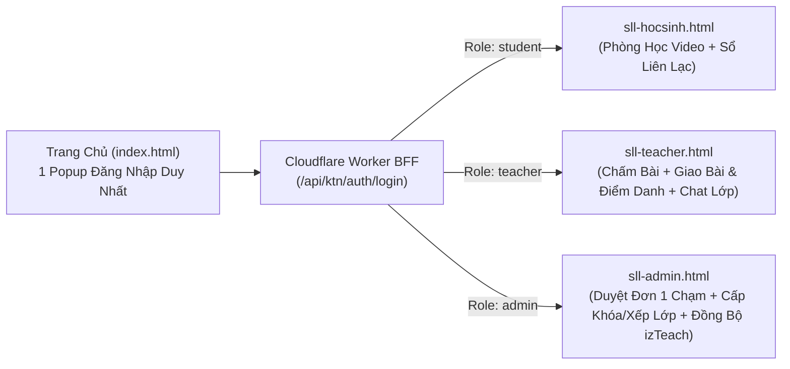

# Học Viện Khổng Tử Nhí (KTN) — Hệ Thống LMS & Sổ Liên Lạc Điện Tử (Web App)

Hệ thống **Cổng Học Viên Trực Tuyến & Sổ Liên Lạc Điện Tử** của **Học Viện Khổng Tử Nhí** (`https://khongtunhi.com`), được thiết kế theo kiến trúc **Headless / Zero-Server-Cost** kết hợp:
1. **Cloudflare Workers BFF Proxy + PWA Push + Cron** ([`cloudflare-worker-sw-proxy.js`](./cloudflare-worker-sw-proxy.js))
2. **Supabase PostgreSQL — 11 Bảng Dữ Liệu** ([`supabase_schema.sql`](./supabase_schema.sql))
3. **izTeach AWS Cloud & CloudFront CDN** (Cognito Auth, Course Entitlements, HLS Video Streaming, S3 Homework Uploads)

---

## 1. Kiến Trúc Tổng Thể & Phân Luồng 3 Vai Trò

Từ **1 Popup Đăng Nhập duy nhất** trên Trang chủ ([`index.html`](./index.html)), hệ thống tự động nhận diện vai trò và điều hướng về **3 trang độc lập**:



| Trang / Module | File nguồn chính | Chức năng cốt lõi |
|---|---|---|
| **Trang Chủ** | [`index.html`](./index.html) | Trang giới thiệu khóa học, tạo đơn đăng ký VietQR và Popup Đăng nhập hợp nhất. |
| **Cổng Học Sinh (Hợp nhất 1 file)** | [`sll-hocsinh.html`](./sll-hocsinh.html)<br>*(Build từ [`portal_template.html`](./portal_template.html))* | Gồm 2 ngăn chuyển 1 chạm trên cùng 1 thanh điều hướng:<br>• **🎬 Phòng Học & Bài Tập**: Xem Video HLS, đọc 5 bộ sách PDF, nghe 127 file MP3, làm Sách bài tập điện tử tương tác & nộp bài tập ảnh/thu âm lên S3.<br>• **📒 Sổ Liên Lạc & Trao Đổi Với Cô**: Xem điểm số, lời phê của cô giáo và nhắn tin trực tiếp với cô chủ nhiệm. |
| **Cổng Giáo Viên** | [`sll-teacher.html`](./sll-teacher.html) | Chấm bài tập học sinh nộp (`0–10` điểm + nhận xét), giao bài & điểm danh buổi học, chat nhóm lớp phụ trách. |
| **Cổng Quản Lý (Admin)** | [`sll-admin.html`](./sll-admin.html) | • **Đơn hàng & Duyệt 1 chạm**: Tự động tạo/tìm tài khoản Cognito và mở khóa học.<br>• **Cấp/Mở thêm khóa học & Xếp lớp**: Ma trận bật/tắt từng khóa học, gói Combo 6 khóa và xếp lớp trực tiếp.<br>• **Kho khóa học & Đồng bộ izTeach**: Đồng bộ 1 chạm khóa học mới tạo thứ 10, 11... từ izTeach.<br>• **Cấu hình Giá & VietQR tự động**: Cập nhật giá bán, số tài khoản nhận tiền và Webhook SePay/Casso. |
| **Lõi Kết Nối Web App** | [`ktn-webapp-client.js`](./ktn-webapp-client.js) | Lưu phiên đăng nhập bền vững 365 ngày (`IndexedDB` + `localStorage` + `Cookie`), gác cổng phân quyền theo trang (`enforceRolePage`) và đăng ký chuông thông báo đẩy PWA (`/sw.js`). |
| **Trạm Gác Cổng Serverless** | [`cloudflare-worker-sw-proxy.js`](./cloudflare-worker-sw-proxy.js) | Giữ kín mật khẩu Admin izTeach trong biến môi trường (`env.IZTEACH_ADMIN_PASSWORD`), ký token HMAC-SHA256, xử lý `/api/ktn/*`, lọc chống rò rỉ SĐT/Zalo (DLP), phục vụ `/sw.js` + `/manifest.json` và chạy Cron `0 3 * * *` chống ngủ đông Supabase Free. |
| **Cơ Sở Dữ Liệu (11 Bảng)** | [`supabase_schema.sql`](./supabase_schema.sql) | Thay thế hoàn toàn cơ chế lưu tạm trong SEO Description cũ bằng 11 bảng PostgreSQL chuẩn hóa trên Supabase. |

---

## 2. Hỗ Trợ Đầy Đủ 4 Kịch Bản Học Sinh & 3 Cách Thêm Khóa Học

### 4 Kịch Bản Học Sinh (`studentCase`)
1. **`both` (Vừa học lớp trực tiếp với cô + Vừa có khóa học Video)**: Hiển thị đồng thời **Thẻ Lớp Trực Tiếp (`🏫 LỚP TRỰC TIẾP: YCT2-04`)** và các **Thẻ Khóa Học Video** ngay trên cùng một kệ khóa học.
2. **`online_only` (Chỉ mua khóa học Video tự học)**: Hiển thị kệ khóa học Video, tự động mở bài giảng và nộp bài tập để cô giáo chấm.
3. **`sll_only` (Chỉ học lớp trực tiếp với cô giáo)**: Tự động mở sẵn ngăn **`📒 Sổ Liên Lạc & Trao Đổi Với Cô`** ngay lần đầu vào trang.
4. **`unassigned` (Tài khoản mới tạo chờ kích hoạt)**: Hiển thị trạng thái chờ kích hoạt kèm nút liên hệ/đăng ký nhanh.

### 3 Cơ Chế Thêm & Mở Rộng Khóa Học (Không Ghi Đè Khóa Cũ)
1. **Tự động khi Duyệt đơn 1 chạm / Webhook VietQR**: Tự động cộng dồn khóa học mới (`filterMissingCourses` + `mergeAndUpsertStudentCourses`), hỗ trợ cả đơn lẻ và gói **Combo 6 Khóa (`BUNDLE_YCT_ALL`)**.
2. **Cấp/Thu hồi thủ công trên trang Admin ([`sll-admin.html`](./sll-admin.html))**: Tích chọn mở thêm hoặc thu hồi bất kỳ khóa nào trong 9+ khóa học và gán mã lớp trực tiếp (`YCT1-01`, `YCT2-04`...).
3. **Đồng bộ 1 chạm khóa học mới (#10+) từ izTeach**: Bấm nút đồng bộ trên [`sll-admin.html`](./sll-admin.html) (`POST /api/ktn/courses/sync-izteach`), hệ thống tự động kéo danh sách bài giảng từ izTeach mà không cần sửa code.

---

## 3. Hướng Dẫn Cài Đặt & Triển Khai

### Bước 1: Khởi tạo Database trên Supabase (Free Tier)
1. Tạo project mới trên [Supabase](https://supabase.com).
2. Mở **SQL Editor**, copy toàn bộ nội dung file [`supabase_schema.sql`](./supabase_schema.sql) và bấm **Run** để khởi tạo 11 bảng cùng dữ liệu danh mục 9 khóa học + 4 kịch bản học viên mẫu.

### Bước 2: Cấu hình Biến Môi Trường & Cloudflare Worker
1. Copy file [`.env.example`](./.env.example) thành `.env` (file `.env` đã được chặn bởi `.gitignore`, tuyệt đối không commit lên Git).
2. Triển khai [`cloudflare-worker-sw-proxy.js`](./cloudflare-worker-sw-proxy.js) lên Cloudflare Workers (theo cấu hình [`wrangler.toml`](./wrangler.toml)) và khai báo các biến Secret:
   * `SUPABASE_URL`
   * `SUPABASE_SERVICE_ROLE_KEY`
   * `IZTEACH_ADMIN_PASSWORD`
   * `SESSION_HMAC_SECRET`
   * `PAYMENT_WEBHOOK_SECRET`

### Bước 3: Build & Deploy Giao Diện Lên Live
* **Build lại [`sll-hocsinh.html`](./sll-hocsinh.html) từ template [`portal_template.html`](./portal_template.html):**
  ```bash
  node build_clean_real_portal.js
  ```
* **Deploy toàn bộ Bundle & 3 trang vai trò lên CloudFront CDN / izTeach Custom Page:**
  ```bash
  node deploy_so_lien_lac_live.cjs
  ```

---

## 4. Tài Liệu Kỹ Thuật Đi Kèm Trong Repo
* [`WEB_APP_READINESS_AUDIT.md`](./WEB_APP_READINESS_AUDIT.md): Báo cáo kiểm toán toàn diện kiến trúc, bảo mật và hiệu năng khi chuyển đổi sang Web App.
* [`IZTEACH_BACKEND_API_SPEC.md`](./IZTEACH_BACKEND_API_SPEC.md): Đặc tả kỹ thuật các endpoint AWS API Gateway & S3 của nền tảng izTeach.
* [`NOTIFICATION_SYSTEM_SPEC.md`](./NOTIFICATION_SYSTEM_SPEC.md): Thiết kế hệ thống thông báo đẩy PWA Web Push (`/sw.js`).
* [`HUONG_DAN_VAN_HANH_HE_THONG.md`](./HUONG_DAN_VAN_HANH_HE_THONG.md) & [`HUONG_DAN_CAP_TAI_KHOAN_VA_PHAN_LOP.md`](./HUONG_DAN_CAP_TAI_KHOAN_VA_PHAN_LOP.md): Sổ tay hướng dẫn vận hành cho Admin và Giáo viên.
